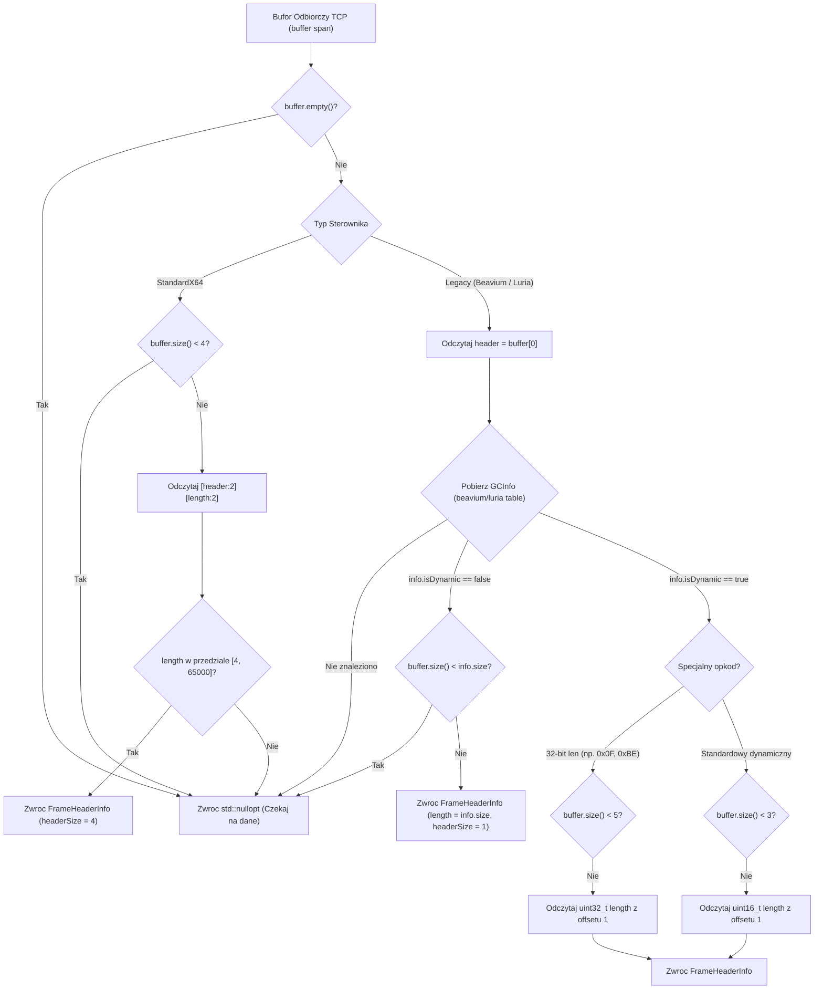

# Struktury Pakietow i Opcodes w Protokole Sieciowym Klienta Metin2

## Spis Tresci
1. [Wprowadzenie i Architektura Ramkowania](#1-wprowadzenie-i-architektura-ramkowania)
2. [Ogolna Struktura Pakietow: Statyczne vs Dynamiczne](#2-ogolna-struktura-pakietow-statyczne-vs-dynamiczne)
3. [Unifikacja vs Legacy Framing: IServerProtocolDriver](#3-unifikacja-vs-legacy-framing-iserverprotocoldriver)
4. [Analiza Porownawcza Profili: Beavium vs Luria](#4-analiza-porownawcza-profili-beavium-vs-luria)
5. [Rejestr Opcodes i Definicji TPacket](#5-rejestr-opcodes-i-definicji-tpacket)
6. [Diagram Przeplywu Inspekcji Ramek (InspectFrame)](#6-diagram-przeplywu-inspekcji-ramek-inspectframe)
7. [Powiazania Kodowe i Referencje](#7-powiazania-kodowe-i-referencje)

---

## 1. Wprowadzenie i Architektura Ramkowania

Komunikacja sieciowa w kliencie gry Metin2 opiera sie na strumieniowym protokole TCP. Ze wzgledu na strumieniowy charakter TCP (gdzie dane moga przychodzic podzielone na dowolne fragmenty lub scalone w pojedynczym wywolaniu `recv`), warstwa klienta musi dokonywac precyzyjnego podzialu bufora wejsciowego na autonomiczne ramki logiczne (tzw. wire framing).

W architekturze nowoczesnego klienta x64 ([IServerProtocolDriver.h](file:///E:/m2dev-client-src-mainOryginalx64/src/Client/Network/Protocol/IServerProtocolDriver.h)) wprowadzono warstwe abstrakcji sterownikow protokolow (UPM - Universal Protocol Module). Klient obsluguje jednoczesnie tradycyjne serwery oparte na 1-bajtowych naglowkach (Ymir Legacy 1B) oraz zunifikowane profile x64 korzystajace z naglowka 4-bajtowego `[Header:2][Length:2]`.

---

## 2. Ogolna Struktura Pakietow: Statyczne vs Dynamiczne

W tradycyjnym protokole Metin2 pakiety przychodzace (Game -> Client, GC) oraz wychodzace (Client -> Game, CG) dziela sie na dwie fundamentalne kategorie:

### 2.1 Pakiety o Stalym Rozmiarze (Static Size)
Posiadaja 1-bajtowy kod operacji (opcode) nastepujacy bezposrednio po zdefiniowanej strukturze C++ (`#pragma pack(push, 1)`):
- Rozmiar pakietu jest znany z gory w momencie kompilacji na podstawie tabeli opkodow.
- Przyklad: `TPacketGCPing` (naglowek 1B + czas serwera 4B = 5 bajtow w standardowym profilu lub 1B w Luria).
- Odbiorca weryfikuje czy w buforze `CNetworkStream` znajduje sie co najmniej `info.size` bajtow i od razu przekazuje dane do handlera.

### 2.2 Pakiety o Zmiennym Rozmiarze (Dynamic Size)
Stosowane do przesylania tekstu czatu, list przedmiotow, skryptow questowych oraz danych dialogowych:
- **Tradycyjne pakiety dynamiczne (Ymir / Luria / MartySama)**:
  - 1 bajt opcode (np. `0x04` dla `HEADER_GC_CHAT`).
  - 2 bajty dlugosci payloadu (`uint16_t length`, little-endian).
  - Minimalna dlugosc ramki wynosi 3 bajty (`header + size`).
  - Dane tekstowe lub tablice struktur nastepuja bezposrednio po polu dlugosci.
- **Specjalne pakiety dynamiczne Beavium / Luria**:
  - Niektore pakiety (np. `0x0F` TSkillCooldownPacket, `0x49` Raw Buffer, `0x6A` Ranking, `0x8A` Pet Info, `0x90`/`0x91` Voice Chat w Beavium, lub `0xBE` w Luria) wykorzystuja 4-bajtowe pole dlugosci (`uint32_t total_size` na offsetcie 1). Minimalny naglowek to 5 lub 6 bajtow.
  - Pakiety miniaturowej mapy (np. Beavium `0x53` `HEADER_GC_MINIMAP_WAYPOINTS`) definiuja staly naglowek 5-bajtowy z liczba rekordow `count` na offsetcie 3 i zmienna dlugoscia `5 + count * 13`.

---

## 3. Unifikacja vs Legacy Framing: IServerProtocolDriver

Interfejs [IServerProtocolDriver](file:///E:/m2dev-client-src-mainOryginalx64/src/Client/Network/Protocol/IServerProtocolDriver.h) standaryzuje badanie bufora TCP za pomoca struktury `FrameHeaderInfo`:

```cpp
struct FrameHeaderInfo
{
    uint16_t unifiedOpcode{0}; ///< Zunifikowany naglowek wewnetrzny
    uint32_t packetLength{0};  ///< Calkowity rozmiar pakietu do odebrania z bufora TCP
    uint32_t headerSize{0};    ///< Rozmiar naglowka (1B dla Beavium/Legacy, 4B dla x64)
};
```

Metoda `InspectFrame(std::span<const uint8_t> buffer)` odpowiada za inspekcje strumienia:
- W sterowniku [StandardX64ProtocolDriver](file:///E:/m2dev-client-src-mainOryginalx64/src/Client/Network/Protocol/Drivers/StandardX64ProtocolDriver.cpp) kazda ramka posiada scisly, 4-bajtowy naglowek:
  ```cpp
  uint16_t header = buffer[0] | (buffer[1] << 8);
  uint32_t length = buffer[2] | (buffer[3] << 8);
  ```
  Zapewnia to przewidywalnosc ramkowania bez koniecznosci utrzymywania setek wpisow tabeli stalych rozmiarow.
- W sterownikach zgodnosciowych ([BeaviumProtocolDriver](file:///E:/m2dev-client-src-mainOryginalx64/src/Client/Network/Protocol/Drivers/BeaviumProtocolDriver.cpp), [LuriaProtocolDriver](file:///E:/m2dev-client-src-mainOryginalx64/src/Client/Network/Protocol/Drivers/LuriaProtocolDriver.cpp), [MartySamaProtocolDriver](file:///E:/m2dev-client-src-mainOryginalx64/src/Client/Network/Protocol/Drivers/MartySamaProtocolDriver.cpp)) metoda uzywa tablicy generowanej w plikach `.inl` i bada pierwszy bajt bufora.

---

## 4. Analiza Porownawcza Profili: Beavium vs Luria

Profile serwerowe posiadaja znaczace rozbieznosci w liczbie obslugiwanych pakietow oraz ich rozmiarach:

### 4.1 Tabela Pakietow GC Beavium
Plik zrodlowy: [src/Client/Network/Protocol/Generated/beavium_gc_table.inl](file:///E:/m2dev-client-src-mainOryginalx64/src/Client/Network/Protocol/Generated/beavium_gc_table.inl)
- **Liczba zarejestrowanych wpisow `case`**: Dokladnie **48 wpisow**.
- **Cechy profilu Beavium**:
  - Bardzo zwarty, wyspecjalizowany zestaw opkodow serwerowych.
  - Pakiety o stalym rozmiarze: np. `case 0x01: { 45, false }` (Character Add), `case 0x02: { 6, false }`, `case 0x07: { 91, false }` (Login Failure), `case 0x0D: { 3073, false }`.
  - Pakiety dynamiczne: np. `case 0x04: { 14, true }` (Chat), `case 0x05: { 3, true }`, `case 0x0F: { 6, true }`, `case 0x1F: { 4, true }`, `case 0x21: { 3, true }`, `case 0x90: { 5, true }` (Voice Chat).
  - Pakiety kontrolne i handshake: `0xFA` (137B), `0xFB` (137B), `0xFD` (2B Phase), `0xFE` (1B Pong), `0xFF` (13B Handshake).

### 4.2 Tabela Pakietow GC Luria
Plik zrodlowy: [src/Client/Network/Protocol/luria_gc_table.inl](file:///E:/m2dev-client-src-mainOryginalx64/src/Client/Network/Protocol/luria_gc_table.inl)
- **Liczba zarejestrowanych wpisow `case`**: Dokladnie **139 wpisow**.
- **Cechy profilu Luria**:
  - Szeroki profil produkcyjny z bogata liczba wlasnych systemow rozgrywki (szarfy, pety, alchemia, zaawansowane sklepy).
  - Pakiety o stalym rozmiarze: np. `case 0x01: { 37, false }` (Character Add w Luria jest mniejszy niz w Beavium - 37B vs 45B), `case 0x06: { 297, false }`, `case 0x10: { 1021, false }`, `case 0x20: { 489, false }` (Login Success), `case 0x4C: { 1531, false }`, `case 0x63: { 2708, false }`.
  - Pakiety dynamiczne: np. `case 0x04: { 9, true }`, `case 0x26: { 4, true }`, `case 0x32: { 4, true }`, `case 0xBE: { 5, true }` (32-bitowy dynamiczny bufor Luria), `case 0xF5: { 3, true }`.
  - Pakiety kryptograficzne i handshake: `0xFD` (2B Phase), `0xFE` (7B Pong/Time), `0xFF` (13B Handshake).

### Zestawienie Porownawcze Struktur Ramkowania

| Cecha Protokolu | Standard x64 (2026) | Beavium Profil | Luria Profil | MartySama Profil |
| :--- | :--- | :--- | :--- | :--- |
| **Dlugosc Naglowka (Header Size)** | 4 Bajty `[Op:2][Len:2]` | 1 Bajt `[Op:1]` | 1 Bajt `[Op:1]` | 1 Bajt `[Op:1]` |
| **Ilosc wpisow tabeli GC** | N/A (Dynamic Dispatch) | 48 wpisow | 139 wpisow | ~50 stalych + custom |
| **Dlugosc pola Dynamic Length** | Wbudowane w naglowek (2B) | 2B lub 4B (zalezne od opkodu) | 2B (0xBE: 4B) | 2B (uint16_t) |
| **Format Pakietu Ruchu (Move)** | `TPacketCGMove` (19B) | Proxy Move (16B) | Luria Move (16B) | `TPacketCGMoveMarty` (16B) |
| **Format Pakietu Ataku (Attack)** | `TPacketCGAttack` (11B) | `ProxyPacketCGAttack` (8B) | Luria Attack (8B) | `TPacketCGAttackMarty` (8B) |

---

## 5. Rejestr Opcodes i Definicji TPacket

Zdefiniowane w [ProtocolOpcodes.h](file:///E:/m2dev-client-src-mainOryginalx64/src/Client/Network/Protocol/ProtocolOpcodes.h) oraz [Protocol_Common.h](file:///E:/m2dev-client-src-mainOryginalx64/src/Client/Network/Protocol/Protocol_Common.h):

### 5.1 Opcodes Wychodzace (Client -> Game, CG)
```cpp
namespace Client::Network::Protocol::CG
{
    constexpr uint16_t CLIENT_VERSION     = 0x000D; // Weryfikacja wersji wykonywalnej
    constexpr uint16_t STATE_CHECKER      = 0x000F;
    constexpr uint16_t TEXT               = 0x0011;

    // Autoryzacja i Postacie
    constexpr uint16_t LOGIN2             = 0x0101; // Logowanie standardowe
    constexpr uint16_t LOGIN3             = 0x0102; // Logowanie z haslem
    constexpr uint16_t LOGIN_SECURE       = 0x0103;
    constexpr uint16_t EMPIRE             = 0x010A;
    constexpr uint16_t CHARACTER_CREATE   = 0x0201;
    constexpr uint16_t CHARACTER_DELETE   = 0x0202;
    constexpr uint16_t CHARACTER_SELECT   = 0x0203;
    constexpr uint16_t ENTERGAME          = 0x0204; // Wejscie do swiata

    // Ruch i Walka
    constexpr uint16_t MOVE               = 0x0301;
    constexpr uint16_t SYNC_POSITION      = 0x0303;
    constexpr uint16_t ATTACK             = 0x0401;
    constexpr uint16_t USE_SKILL          = 0x0402;
    constexpr uint16_t SHOOT              = 0x0403;

    // Ekwipunek
    constexpr uint16_t ITEM_USE           = 0x0501;
    constexpr uint16_t ITEM_DROP          = 0x0502;
    constexpr uint16_t ITEM_MOVE          = 0x0504;
    constexpr uint16_t ITEM_PICKUP        = 0x0505;
}
```

### 5.2 Opcodes Przychodzace (Game -> Client, GC)
```cpp
namespace Client::Network::Protocol::GC
{
    constexpr uint16_t RESPOND_CHANNELSTATUS = 0x0010;

    // Fazy i Autoryzacja
    constexpr uint16_t LOGIN_SUCCESS3     = 0x0104;
    constexpr uint16_t LOGIN_FAILURE      = 0x0106;
    constexpr uint16_t LOGIN_KEY          = 0x0107;
    constexpr uint16_t EMPIRE             = 0x0109;

    // Zarzadzanie Postaciami
    constexpr uint16_t CHARACTER_ADD      = 0x0205;
    constexpr uint16_t CHAR_ADDITIONAL_INFO = 0x0207;
    constexpr uint16_t CHARACTER_DEL      = 0x0208;
    constexpr uint16_t CHARACTER_UPDATE   = 0x0209;
    constexpr uint16_t MAIN_CHARACTER     = 0x0210;
    constexpr uint16_t PLAYER_POINTS      = 0x0214;
    constexpr uint16_t PLAYER_POINT_CHANGE= 0x0215;

    // Ruch i Swiat
    constexpr uint16_t MOVE               = 0x0302;
    constexpr uint16_t SYNC_POSITION      = 0x0304;
    constexpr uint16_t WARP               = 0x0306;
}
```

---

## 6. Diagram Przeplywu Inspekcji Ramek (InspectFrame)

Ponizszy diagram obrazuje algorytm podejmowania decyzji o odczycie z bufora TCP w warstwie sterownika protokolu:



---

## 7. Powiazania Kodowe i Referencje

- Interfejs sterownikow: [IServerProtocolDriver.h](file:///E:/m2dev-client-src-mainOryginalx64/src/Client/Network/Protocol/IServerProtocolDriver.h#L27-L54)
- Sterownik x64: [StandardX64ProtocolDriver.cpp](file:///E:/m2dev-client-src-mainOryginalx64/src/Client/Network/Protocol/Drivers/StandardX64ProtocolDriver.cpp#L12-L35)
- Tablica opkodow Beavium (48 wpisow): [beavium_gc_table.inl](file:///E:/m2dev-client-src-mainOryginalx64/src/Client/Network/Protocol/Generated/beavium_gc_table.inl)
- Tablica opkodow Luria (139 wpisow): [luria_gc_table.inl](file:///E:/m2dev-client-src-mainOryginalx64/src/Client/Network/Protocol/luria_gc_table.inl)
- Sterownik Beavium: [BeaviumProtocolDriver.cpp](file:///E:/m2dev-client-src-mainOryginalx64/src/Client/Network/Protocol/Drivers/BeaviumProtocolDriver.cpp#L30-L130)
- Sterownik Luria: [LuriaProtocolDriver.cpp](file:///E:/m2dev-client-src-mainOryginalx64/src/Client/Network/Protocol/Drivers/LuriaProtocolDriver.cpp#L20-L80)
- Sterownik MartySama: [MartySamaProtocolDriver.cpp](file:///E:/m2dev-client-src-mainOryginalx64/src/Client/Network/Protocol/Drivers/MartySamaProtocolDriver.cpp#L120-L240)
- Opcodes klienta: [ProtocolOpcodes.h](file:///E:/m2dev-client-src-mainOryginalx64/src/Client/Network/Protocol/ProtocolOpcodes.h)
