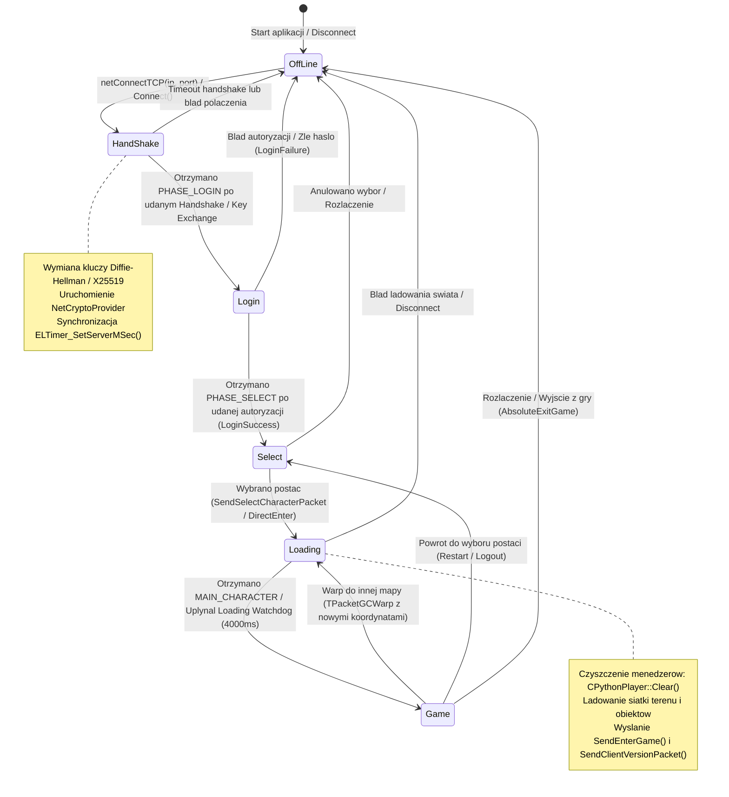

# Automat Stanow Faz Klienta (Phase State Machine)

## Spis Tresci
1. [Wprowadzenie do Architektury Fazowej](#1-wprowadzenie-do-architektury-fazowej)
2. [7 Faz Polaczenia Klienta: Enumy i Reprezentacja](#2-7-faz-polaczenia-klienta-enumy-i-reprezentacja)
3. [Diagram Maszyny Stanow (Mermaid stateDiagram-v2)](#3-diagram-maszyny-stanow-mermaid-statediagram-v2)
4. [Tabelaryczna Rejestracja Handlerow Pakietow per Faza](#4-tabelaryczna-rejestracja-handlerow-pakietow-per-faza)
5. [Szczegolowy Przebieg Cyklu Zycia Faz](#5-szczegolowy-przebieg-cyklu-zycia-faz)
6. [Modul Fast-Boot / Direct-to-World (Dear ImGui DX9)](#6-modul-fast-boot--direct-to-world-dear-imgui-dx9)
7. [Powiazania Kodowe i Referencje](#7-powiazania-kodowe-i-referencje)

---

## 1. Wprowadzenie do Architektury Fazowej

Klient gry Metin2 zarzadza caloscia sesji sieciowej za pomoca deterministycznej maszyny stanow (Finite State Machine). Kazda faza odpowiada za scisle okreslony etap interakcji z infrastruktura serwerowa - od zestawienia polaczenia TCP i negocjacji kryptograficznej, poprzez autoryzacje konta, wybor postaci, synchronizacje zasobow swiata, az po ciagla petle rozgrywki (Game Loop).

Zmiana stanu sterowana jest glownie przez pakiety serwerowe `HEADER_GC_PHASE` (`0xFD` lub `0x0200` w zaleznosci od protokolu), a takze przez akcje uzytkownika wywolywane z poziomu interfejsu Pythona lub nakladki Dear ImGui.

---

## 2. 7 Faz Polaczenia Klienta: Enumy i Reprezentacja

W kodzie zrodlowym wyroznia sie dwie warstwy definicji faz:

### 2.1 Enum Protokolowy: `EPhases`
Zdefiniowany w [Protocol_Common.h](file:///E:/m2dev-client-src-mainOryginalx64/src/Client/Network/Protocol/Protocol_Common.h#L17-L31):
```cpp
enum EPhases
{
    PHASE_CLOSE              = 0,  ///< Zamkniecie polaczenia / rozlaczenie
    PHASE_HANDSHAKE          = 1,  ///< Negocjacja kluczy, synchronizacja czasu
    PHASE_LOGIN              = 2,  ///< Uwierzytelnianie konta (Auth / Login)
    PHASE_SELECT             = 3,  ///< Wybor krolestwa i postaci
    PHASE_LOADING            = 4,  ///< Ladowanie mapy, terenu i jednostek
    PHASE_GAME               = 5,  ///< Wlasciwa rozgrywka MMO
    PHASE_DEAD               = 6,  ///< Stan smierci glownego aktora
    PHASE_CLIENT_CONNECTING  = 7,
    PHASE_DBCLIENT           = 8,
    PHASE_P2P                = 9,
    PHASE_AUTH               = 10,
};
```

### 2.2 Nazwy Stanow i Okna UI w `CPythonNetworkStream`
W klasie [CPythonNetworkStream](file:///E:/m2dev-client-src-mainOryginalx64/src/UserInterface/PythonNetworkStream.h#L76-L86) aktualny stan wewnetrzny jest reprezentowany przez pole `std::string m_strPhase`:
- `"OffLine"`: Brak aktywnego gniazda TCP.
- `"HandShake"`: Polaczenie ustanowione, trwa wymiana kluczy (DH2 / X25519) i synchronizacja zegara `ELTimer`.
- `"Login"`: Oczekiwanie na odpowiedz autoryzacyjna serwera gry.
- `"Select"`: Zarzadzanie postaciami na koncie (tworzenie, usuwanie, wybor).
- `"Loading"`: Przesylanie parametrow startowych gracza i ladowanie terenu.
- `"Game"`: Obsluga zdarzen dynamicznych, walki, ekwipunku i ruchu.

Okna interfejsu uzytkownika powiazane z fazami:
```cpp
enum
{
    PHASE_WINDOW_LOGO,
    PHASE_WINDOW_LOGIN,
    PHASE_WINDOW_SELECT,
    PHASE_WINDOW_CREATE,
    PHASE_WINDOW_LOAD,
    PHASE_WINDOW_GAME,
    PHASE_WINDOW_EMPIRE,
    PHASE_WINDOW_NUM,
};
```

---

## 3. Diagram Maszyny Stanow (Mermaid stateDiagram-v2)

Ponizszy diagram ilustruje sekwencje przejsc miedzy fazami klienta:



---

## 4. Tabelaryczna Rejestracja Handlerow Pakietow per Faza

W nowoczesnej architekturze klienta (Phase 5 Refactoring w [PythonNetworkStream.cpp](file:///E:/m2dev-client-src-mainOryginalx64/src/UserInterface/PythonNetworkStream.cpp#L843-L1175)) zrezygnowano z wielkich instrukcji `switch-case` na rzecz tabelarycznej dyspozycji pakietow:

```cpp
struct PacketHandlerEntry {
    bool (CPythonNetworkStream::*handler)();
    uint16_t minSize;
    bool exitPhase; // true = przerwij petle dispatchera po obsludze (zmiana fazy)
};
using PacketHandlerMap = std::unordered_map<uint16_t, PacketHandlerEntry>;
```

Kazda faza posiada wlasna, dedykowana tablice handlerow:
- `m_offlineHandlers`
- `m_handshakeHandlers`
- `m_loginHandlers`
- `m_selectHandlers`
- `m_loadingHandlers`
- `m_gameHandlers`

Metoda `RefreshProtocolHandlers()` odswieza powyzsze tablice na podstawie aktualnie aktywnego sterownika w `ProtocolDriverRegistry`. Dzieki temu np. profil **Luria** uzywa handlerow `RecvPhasePacketLuria`, `RecvHandshakePacketLuria`, a profil **Standard x64** uzywa standardowych struktur `TPacketGCPhase`.

### Przelaczanie delegatow procesowania faz:
Podczas wejscia do kazdej fazy (np. `SetLoginPhase()`) wykonywane sa nastepujace czynnosci:
1. Wywolanie poprzedniej funkcji wyjsciowej: `m_phaseLeaveFunc.Run();`
2. Aktualizacja nazwy: `m_strPhase = "Login";`
3. Przeladowanie tabeli: `RefreshProtocolHandlers();`
4. Podpiecie petli procesowania: `m_phaseProcessFunc.Set(this, &CPythonNetworkStream::LoginPhase);`
5. Podpiecie funkcji sprzatajacej wyjscia: `m_phaseLeaveFunc.Set(this, &CPythonNetworkStream::__LeaveLoginPhase);`
6. Zapis znacznika czasu zmiany fazy: `m_dwChangingPhaseTime = ELTimer_GetMSec();`

---

## 5. Szczegolowy Przebieg Cyklu Zycia Faz

### 5.1 Faza HandShake
Plik zrodlowy: [PythonNetworkStreamPhaseHandShake.cpp](file:///E:/m2dev-client-src-mainOryginalx64/src/UserInterface/PythonNetworkStreamPhaseHandShake.cpp)
- **Rola**: Negocjacja protokolu sieciowego, uzgodnienie wspolnego klucza symetrycznego (np. Blowfish CTR w Luria DH2 lub Sodium XChaCha20 w Beavium) oraz synchronizacja czasu.
- **Kluczowe pakiety**: `HEADER_GC_HANDSHAKE`, `HEADER_GC_KEY_CHALLENGE`, `HEADER_GC_KEY_AGREEMENT`.
- **Logika**: Metoda `RecvKeyChallenge()` przechwytuje czas serwera (`packet.server_time`), konfiguruje `ELTimer_SetServerMSec()` oraz bazowy czas silnika `CTimer::Instance().SetBaseTime()`. Po zakonczeniu aktywuje szyfrator strumieniowy na gniezdzie TCP.

### 5.2 Faza Login
Plik zrodlowy: [PythonNetworkStreamPhaseLogin.cpp](file:///E:/m2dev-client-src-mainOryginalx64/src/UserInterface/PythonNetworkStreamPhaseLogin.cpp)
- **Rola**: Uwierzytelnienie konta gracza na serwerze autoryzacyjnym lub bezposrednio w serwerze gry.
- **Wysylka**: `SendLoginPacketNew(m_stID.c_str(), m_stPassword.c_str())` kodowane przez aktywny sterownik (`EncodeLogin` / `EncodeAuthLogin`).
- **Odbior**: Handlery `LOGIN_SUCCESS3`, `LOGIN_SUCCESS4`, `LOGIN_FAILURE`, `EMPIRE`. Po sukcesie serwer odsyla pakiet `PHASE_SELECT`.

### 5.3 Faza Select
Plik zrodlowy: [PythonNetworkStreamPhaseSelect.cpp](file:///E:/m2dev-client-src-mainOryginalx64/src/UserInterface/PythonNetworkStreamPhaseSelect.cpp)
- **Rola**: Prezentacja listy postaci na koncie, wybor krolestwa (`SendSelectEmpirePacket`), tworzenie nowej postaci (`SendCreateCharacterPacket`) lub usuniecie (`SendDestroyCharacterPacket`).
- **Wsparcie Fast-Boot**: Jezeli ustawiony jest tryb `__DirectEnterMode_IsSet()`, faza automatycznie wysyla `SendSelectCharacterPacket(slot)` i wywoluje przejscie do `SetLoadingPhase()` z pominieciem ekranow UI.

### 5.4 Faza Loading
Plik zrodlowy: [PythonNetworkStreamPhaseLoading.cpp](file:///E:/m2dev-client-src-mainOryginalx64/src/UserInterface/PythonNetworkStreamPhaseLoading.cpp)
- **Rola**: Przygotowanie srodowiska 3D klienta do renderowania mapy.
- **Sprzatanie**: Czyszczenie instancji gracza (`CPythonPlayer::Instance().Clear()`), usuwanie pociskow (`CFlyingManager::Instance().DeleteAllInstances()`) oraz efektow czasteczkowych (`CEffectManager::Instance().DeleteAllInstances()`).
- **Identyfikacja Postaci**: Odbior pakietu `MAIN_CHARACTER` (lub profilowych `RecvMainCharacterLuria8A`, `RecvMainCharacterLuria0F`), przypisanie VID bohatera, rasy, krolestwa i pozycji spawn (`lX`, `lY`).
- **Finalizacja**: Wyslanie `SendEnterGame()`, `SendClientVersionPacket()` oraz powiadomienie pythona `LoadData(x, y)`.
- **Mechanizm Loading Watchdog**: Jezeli po 4000 milisekundach serwer nie przetransmituje pakietu zakonczenia ladowania, klient automatycznie wymusza ponowne wyslanie `SendEnterGame()` i aktywuje `GamePhase()`, zapobiegajac zacieciu klienta na czarnym ekranie.

### 5.5 Faza Game
Pliki zrodlowe: [PythonNetworkStreamPhaseGame.cpp](file:///E:/m2dev-client-src-mainOryginalx64/src/UserInterface/PythonNetworkStreamPhaseGame.cpp), [PythonNetworkStreamPhaseGameSync.cpp](file:///E:/m2dev-client-src-mainOryginalx64/src/UserInterface/PythonNetworkStreamPhaseGameSync.cpp)
- **Rola**: Ciagly obieg gry - poruszanie sie postaci, walka, dynamiczne obiekty potworow i NPC, system party, gildie, handel i czat.
- **Utrzymanie polaczenia**: Cykliczny ping-pong serwerowy (`RecvPingPacket` -> `Send(HEADER_CG_PONG)`), synchronizujacy dodatkowo tickrate zegara serwerowego.
- **Warpowanie miedzy mapami**: Metoda `PhaseGameSyncBridge::HandleWarp()` niszczy i odbudowuje teren tla (`CPythonBackground`), po czym w razie koniecznosci laczy z nowym portem instancji kanalu gry.

---

## 6. Modul Fast-Boot / Direct-to-World (Dear ImGui DX9)

Zaimplementowany w [FastBootOverlay.cpp](file:///E:/m2dev-client-src-mainOryginalx64/src/UserInterface/FastBootOverlay.cpp). Modul ten jest rozwiazaniem umozliwiajacym deweloperom i testerom natychmiastowe dolaczenie do swiata gry z pominieciem ciezkich, wolnych skryptow Python UI (`introLogo.py`, `introLogin.py`, `introSelect.py`).

### Cechy Architektoniczne Fast-Boot:
1. **Renderowanie bezposrednio w DirectX 9**: Wykorzystuje biblioteke Dear ImGui zintegrowana w petli glownej gry ([FastBootOverlay::Render](file:///E:/m2dev-client-src-mainOryginalx64/src/UserInterface/FastBootOverlay.cpp#L346-L420)).
2. **Dynamiczny wybor profilu serwera**: Zintegrowany z `ProtocolDriverRegistry`. Automatycznie przelacza sterownik na `luria`, `standard_x64` lub `beavium` oraz konfiguruje odpowiednie adresy IP i porty Auth/Game.
3. **Sterowanie DirectEnterMode**: Metoda `CPythonNetworkStream::SetDirectEnterMode(slot)` informuje maszyne stanow, aby po odebraniu `PHASE_SELECT` natychmiast wyslala pakiet wyboru wskazanego slotu i bezposrednio uruchomila faze `Loading`.
4. **Auto-Hide**: Po wykryciu wejscia w faze `Game` nakladka automatycznie ukrywa sie (`m_bAutoHidden = true; m_bVisible = false;`). Dostep do menu mozliwy jest w dowolnym momencie pod klawiszem **F11**.

---

## 7. Powiazania Kodowe i Referencje

- Klasa glownego strumienia: [PythonNetworkStream.h](file:///E:/m2dev-client-src-mainOryginalx64/src/UserInterface/PythonNetworkStream.h#L340-L382)
- Rejestracja handlerow i obsluga faz: [PythonNetworkStream.cpp](file:///E:/m2dev-client-src-mainOryginalx64/src/UserInterface/PythonNetworkStream.cpp#L530-L635)
- Faza Handshake: [PythonNetworkStreamPhaseHandShake.cpp](file:///E:/m2dev-client-src-mainOryginalx64/src/UserInterface/PythonNetworkStreamPhaseHandShake.cpp)
- Faza Login: [PythonNetworkStreamPhaseLogin.cpp](file:///E:/m2dev-client-src-mainOryginalx64/src/UserInterface/PythonNetworkStreamPhaseLogin.cpp)
- Faza Select: [PythonNetworkStreamPhaseSelect.cpp](file:///E:/m2dev-client-src-mainOryginalx64/src/UserInterface/PythonNetworkStreamPhaseSelect.cpp)
- Faza Loading i Watchdog: [PythonNetworkStreamPhaseLoading.cpp](file:///E:/m2dev-client-src-mainOryginalx64/src/UserInterface/PythonNetworkStreamPhaseLoading.cpp#L62-L106)
- Faza Game i Synchronizacja: [PythonNetworkStreamPhaseGameSync.cpp](file:///E:/m2dev-client-src-mainOryginalx64/src/UserInterface/PythonNetworkStreamPhaseGameSync.cpp#L210-L238)
- Nakladka Fast-Boot: [FastBootOverlay.cpp](file:///E:/m2dev-client-src-mainOryginalx64/src/UserInterface/FastBootOverlay.cpp)
