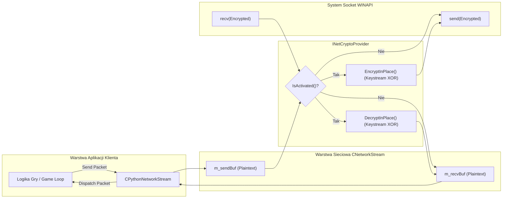

# Dostawcy Kryptografii Sieciowej (Crypto Providers: TEA, Blowfish, Sodium)

## Spis Tresci
1. [Wprowadzenie do Warstwy Kryptograficznej Klienta](#1-wprowadzenie-do-warstwy-kryptograficznej-klienta)
2. [Interfejs INetCryptoProvider](#2-interfejs-inetcryptoprovider)
3. [Implementacja 1: TEA i SecureCipher (Modern C++20 / libsodium)](#3-implementacja-1-tea-i-securecipher-modern-c20--libsodium)
4. [Implementacja 2: BlowfishCryptoProvider (Tryb CTR dla Luria DH2)](#4-implementacja-2-blowfishcryptoprovider-tryb-ctr-dla-luria-dh2)
5. [Implementacja 3: SodiumCryptoProvider (XChaCha20 dla Beavium / Standard x64)](#5-implementacja-3-sodiumcryptoprovider-xchacha20-dla-beavium--standard-x64)
6. [Integracja ze Sterownikami Protokolow i CNetworkStream](#6-integracja-ze-sterownikami-protokolow-i-cnetworkstream)
7. [Diagram Przeplywu Danych Kryptograficznych](#7-diagram-przeplywu-danych-kryptograficznych)
8. [Powiazania Kodowe i Referencje](#8-powiazania-kodowe-i-referencje)

---

## 1. Wprowadzenie do Warstwy Kryptograficznej Klienta

Oryginalny klient Metin2 firmy Ymir stosowal prosty, podatny na ataki algorytm TEA (Tiny Encryption Algorithm) ze statycznym kluczem lub trywialnym XOR. W nowoczesnym kliencie x64 architektura zostala calkowicie unowoczesniona - wprowadzono zunifikowany interfejs abstrakcyjny `INetCryptoProvider`, umozliwiajacy wstrzykiwanie dowolnych algorytmow kryptograficznych w czasie rzeczywistym.

Dzieki temu klient moze jednoczesnie komunikowac sie z:
- Serwerami nowoczesnymi korzystajacymi z asymetrycznej wymiany kluczy X25519 oraz symetrycznego szyfru strumieniowego XChaCha20 ([SodiumCryptoProvider](file:///E:/m2dev-client-src-mainOryginalx64/src/EterLib/SodiumCryptoProvider.h)).
- Serwerami produkcyjnymi uzywajacymi wlasnych protokolow wymiany kluczy Diffie-Hellman DH2 z szyfrowaniem Blowfish w trybie licznika CTR ([BlowfishCryptoProvider](file:///E:/m2dev-client-src-mainOryginalx64/src/EterLib/BlowfishCryptoProvider.h)).
- Klasycznymi srodowiskami testowymi bazujacymi na pamieciowo-bezpiecznym standardzie TEA C++20 ([TeaModern](file:///E:/m2dev-client-src-mainOryginalx64/src/EterBase/TeaModern.h)).

---

## 2. Interfejs INetCryptoProvider

Czysty interfejs zdefiniowany w [NetCryptoProvider.h](file:///E:/m2dev-client-src-mainOryginalx64/src/EterLib/NetCryptoProvider.h) ujednolica operacje kryptograficzne na poziomie gniazda TCP:

```cpp
class INetCryptoProvider
{
public:
    virtual ~INetCryptoProvider() = default;

    /**
     * @brief Szyfruje bufor danych in-place (strumieniowo dla pakietow wychodzacych TX).
     */
    virtual void EncryptInPlace(void* buffer, size_t len) = 0;

    /**
     * @brief Deszyfruje bufor danych in-place (strumieniowo dla pakietow przychodzacych RX).
     */
    virtual void DecryptInPlace(void* buffer, size_t len) = 0;

    /**
     * @brief Zwraca true, jesli szyfrowanie/deszyfrowanie jest aktywne.
     */
    virtual bool IsActivated() const noexcept = 0;

    /**
     * @brief Aktywuje lub dezaktywuje szyfrowanie sieciowe.
     */
    virtual void SetActivated(bool value) noexcept = 0;

    /**
     * @brief Czysci klucze, stany wewnetrzne i zeruje bufory pamieci.
     */
    virtual void CleanUp() noexcept = 0;

    /**
     * @brief Zwraca czytelna nazwe providera (np. "Sodium", "Blowfish").
     */
    virtual std::string_view GetProviderName() const noexcept = 0;
};
```

Zalety takiego podejscia:
- **Operacje In-Place**: Brak alokacji dodatkowych buforow pamieci w petli transmisyjnej (Zero-Copy overhead).
- **Strumieniowosc**: Bufor moze miec dowolna dlugosc (w odroznieniu od starych szyfrow blokowych wymagajacych dopelniania paddingiem do 8 bajtow).
- **Bezpieczenstwo watkowe**: Implementacje chronia stany kanalow nadawczych i odbiorczych odrebnymi muteksami.

---

## 3. Implementacja 1: TEA i SecureCipher (Modern C++20 / libsodium)

### 3.1 Klasa `TeaModern`
Plik zrodlowy: [TeaModern.h](file:///E:/m2dev-client-src-mainOryginalx64/src/EterBase/TeaModern.h)
Nowoczesna reimplementacja algorytmu TEA w C++20 bez uzycia surowych wskaznikow i przestarzalego rzutowania pamieci:
- **Klucz**: 128-bitowy (`KeySize = 16` bajtow).
- **Rozmiar Bloku**: 64-bitowy (`BlockSize = 8` bajtow).
- **Stala delta**: `0x9e3779b9`, 32 cykle rund Feistela.
- **API oparte na `std::span`**: Bezpieczne przetwarzanie buforow za pomoca `TeaModern::Encrypt(std::span<uint8_t> buffer, std::span<const uint8_t> key)`.

### 3.2 Klasa `SecureCipher`
Plik zrodlowy: [SecureCipher.h](file:///E:/m2dev-client-src-mainOryginalx64/src/EterBase/SecureCipher.h)
Niskopoziomowy silnik kryptograficzny oparty o oficjalna biblioteke **libsodium**:
- **Uzgodnienie kluczy**: Wykorzystuje mechanizm `crypto_kx` oparty o krzywa eliptyczna Curve25519 (X25519) generujac klucz publiczny i prywatny o rozmiarze 32 bajtow.
- **Klucze sesyjne**: Klient i serwer niezaleznie wyliczaja unikalne klucze sesyjne:
  - `m_tx_key`: 32-bajtowy klucz dla strumienia wychodzacego klienta.
  - `m_rx_key`: 32-bajtowy klucz dla strumienia przychodzacego do klienta.
- **Szyfrowanie Strumieniowe XChaCha20**: Metody `EncryptInPlace` oraz `DecryptInPlace` inkrementuja 64-bitowe liczniki bajtow `m_tx_nonce` i `m_rx_nonce`, uniemozliwiajac ataki typu replay oraz zapewniajac bezpieczenstwo dla danych o dowolnym rozmiarze bez narzutu taga uwierzytelniajacego (tag-less AEAD stream).

---

## 4. Implementacja 2: BlowfishCryptoProvider (Tryb CTR dla Luria DH2)

Pliki zrodlowe: [BlowfishCryptoProvider.h](file:///E:/m2dev-client-src-mainOryginalx64/src/EterLib/BlowfishCryptoProvider.h), [BlowfishCryptoProvider.cpp](file:///E:/m2dev-client-src-mainOryginalx64/src/EterLib/BlowfishCryptoProvider.cpp)

Implementacja ta zostala stworzona specjalnie pod katem obslugi protokolu serwera produkcyjnego **Luria**, wykorzystujacego procedure LuriaDH2:
- **Tryb pracy**: Blowfish CTR (Counter Mode). Przeksztalca szyfr blokowy o dlugosci bloku 64 bitow (8 bajtow) w ciagly szyfr strumieniowy.
- **Rozmiar klucza**: Wspiera klucze od 4 do 56 bajtow (`MIN_KEY_SIZE = 4`, `MAX_KEY_SIZE = 56`).
- **Niezalezne stany kanalow**:
  ```cpp
  struct ChannelState
  {
      std::array<uint32_t, 18> p{};
      std::array<std::array<uint32_t, 256>, 4> s{};
      std::array<uint8_t, BLOCK_SIZE> counter{};
      std::array<uint8_t, BLOCK_SIZE> keystream{};
      size_t blockOffset = 0;
      bool initialized = false;
  };
  ChannelState m_txChannel;
  ChannelState m_rxChannel;
  ```
- **Inkrementacja licznika**: Duzy licznik big-endian (`IncrementCounter`), zwiekszany przy generowaniu kazdego nowego bloku strumienia klucza (keystream block).
- **Konfiguracja kluczy**: Metoda `SetKeys(txKey, txIv, rxKey, rxIv)` inicjalizuje tablice P oraz S-boxy Blowfisha niezaleznie dla nadawania i odbioru, co zapobiega kolizjom strumieni.

---

## 5. Implementacja 3: SodiumCryptoProvider (XChaCha20 dla Beavium / Standard x64)

Pliki zrodlowe: [SodiumCryptoProvider.h](file:///E:/m2dev-client-src-mainOryginalx64/src/EterLib/SodiumCryptoProvider.h), [SodiumCryptoProvider.cpp](file:///E:/m2dev-client-src-mainOryginalx64/src/EterLib/SodiumCryptoProvider.cpp)

Adapter w architekturze adaptera/wrappera (Adapter Pattern) laczacy interfejs `INetCryptoProvider` ze sprawdzonym silnikiem `SecureCipher`:
- **Wielowatkowosc**: Zaopatrzony w muteksy `m_txMutex` i `m_rxMutex`, gwarantujace bezpieczne wywolania w srodowisku wielowatkowym klienta x64.
- **Bezposredni dostep**: Udostepnia referencje `GetCipher()`, co pozwala sterownikom protokolu (np. `BeaviumProtocolDriver`) pobrac klucz publiczny X25519 przed zestawieniem sesji i przekazac go w pakiecie `HEADER_CG_KEY_AGREEMENT`.

```cpp
void SodiumCryptoProvider::EncryptInPlace(void* buffer, size_t len)
{
    if (!m_cipher.IsActivated() || !buffer || len == 0)
        return;

    std::lock_guard<std::mutex> lock(m_txMutex);
    m_cipher.EncryptInPlace(buffer, len);
}
```

---

## 6. Integracja ze Sterownikami Protokolow i CNetworkStream

W klasie [CNetworkStream](file:///E:/m2dev-client-src-mainOryginalx64/src/EterLib/NetStream.h#L73-L74) dostawca kryptografii jest przechowywany w inteligentnym wskazniku:
```cpp
void SetCryptoProvider(std::shared_ptr<INetCryptoProvider> provider) { m_pCryptoProvider = std::move(provider); }
INetCryptoProvider* GetCryptoProvider() const { return m_pCryptoProvider.get(); }
```

### Schemat Aktywacji:
1. **Nawiazanie polaczenia**: Gniazdo TCP laczy sie w trybie jawnym (clear-text).
2. **Obsluga pakietu Handshake**:
   - Dla profilu **Luria**: Pakiet `HEADER_GC_KEY_AGREEMENT` (0xFA) przekazuje parametry DH2. Sterownik [LuriaProtocolDriver](file:///E:/m2dev-client-src-mainOryginalx64/src/Client/Network/Protocol/Drivers/LuriaProtocolDriver.cpp#L339) tworzy instancje `BlowfishCryptoProvider`, konfiguruje klucze sesyjne i wstrzykuje go do `stream.SetCryptoProvider(blowfish)`.
   - Dla profilu **Beavium**: Sterownik [BeaviumProtocolDriver](file:///E:/m2dev-client-src-mainOryginalx64/src/Client/Network/Protocol/Drivers/BeaviumProtocolDriver.cpp#L388) tworzy `SodiumCryptoProvider`, wykonuje wymiane kluczy X25519 z serwerem i wywoluje `stream.SetCryptoProvider(sodiumProvider)`.
3. **Automatyczne szyfrowanie w petli TCP**:
   - `CNetworkStream::__SendInternalBuffer()`: Przekazuje dane przez `m_pCryptoProvider->EncryptInPlace(buf, len)` tuz przed wywolaniem systemowego `send()`.
   - `CNetworkStream::__RecvInternalBuffer()`: Natychmiast po wywolaniu systemowego `recv()` wywoluje `m_pCryptoProvider->DecryptInPlace(buf, len)`.

---

## 7. Diagram Przeplywu Danych Kryptograficznych

Ponizszy diagram ilustruje role `INetCryptoProvider` w cyklu zycia pakietow:



---

## 8. Powiazania Kodowe i Referencje

- Interfejs dostawcy: [NetCryptoProvider.h](file:///E:/m2dev-client-src-mainOryginalx64/src/EterLib/NetCryptoProvider.h)
- Algorytm Blowfish CTR: [BlowfishCryptoProvider.h](file:///E:/m2dev-client-src-mainOryginalx64/src/EterLib/BlowfishCryptoProvider.h) oraz [BlowfishCryptoProvider.cpp](file:///E:/m2dev-client-src-mainOryginalx64/src/EterLib/BlowfishCryptoProvider.cpp)
- Algorytm Sodium XChaCha20: [SodiumCryptoProvider.h](file:///E:/m2dev-client-src-mainOryginalx64/src/EterLib/SodiumCryptoProvider.h) oraz [SodiumCryptoProvider.cpp](file:///E:/m2dev-client-src-mainOryginalx64/src/EterLib/SodiumCryptoProvider.cpp)
- Silnik libsodium X25519: [SecureCipher.h](file:///E:/m2dev-client-src-mainOryginalx64/src/EterBase/SecureCipher.h) oraz [SecureCipher.cpp](file:///E:/m2dev-client-src-mainOryginalx64/src/EterBase/SecureCipher.cpp)
- Implementacja TEA Modern C++20: [TeaModern.h](file:///E:/m2dev-client-src-mainOryginalx64/src/EterBase/TeaModern.h)
- Integracja gniazda bazowego: [NetStream.h](file:///E:/m2dev-client-src-mainOryginalx64/src/EterLib/NetStream.h#L73-L112)
- Rejestracja kryptografii w Handshake: [PythonNetworkStreamPhaseHandShake.cpp](file:///E:/m2dev-client-src-mainOryginalx64/src/UserInterface/PythonNetworkStreamPhaseHandShake.cpp#L190-L275)
- Rejestracja w sterownikach UPM: [LuriaProtocolDriver.cpp](file:///E:/m2dev-client-src-mainOryginalx64/src/Client/Network/Protocol/Drivers/LuriaProtocolDriver.cpp#L339) oraz [BeaviumProtocolDriver.cpp](file:///E:/m2dev-client-src-mainOryginalx64/src/Client/Network/Protocol/Drivers/BeaviumProtocolDriver.cpp#L388)
