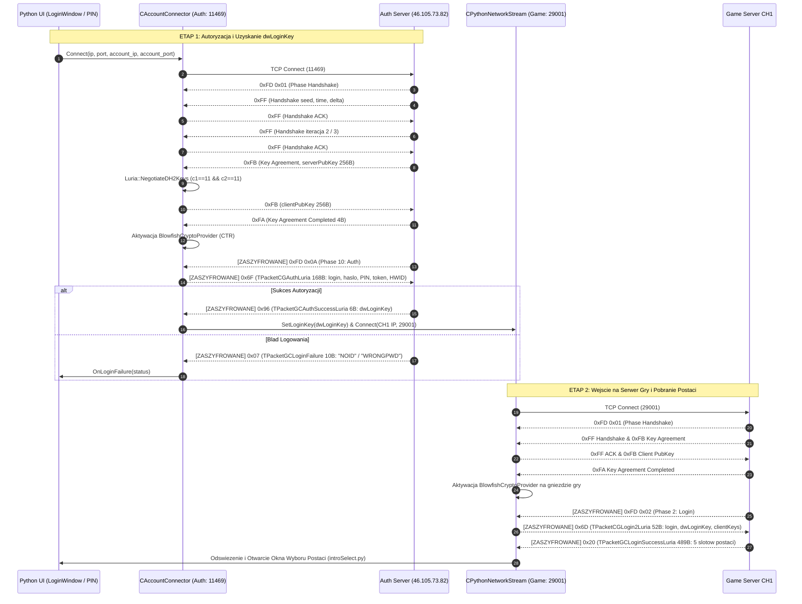

# Specyfikacja Protokolu i Bezpieczenstwa: Profil Luria (LuriaProtocolDriver & DH2 Blowfish CTR)

## 1. Cel Architektoniczny i Rola Profilu

Profil serwerowy `luria` stanowi implementacje sterownika protokolu w architekturze **Universal Protocol Matrix (UPM)** dla custom klienta gier Metin2 (C++23 x64). Profil ten pozwala na w pelni natywne, stabilne polaczenie klienta z serwerami rodziny Luria (np. `46.105.73.82:11469` Auth, porty gry `29001` CH1), zachowujac pelna separacje od profili `standard_x64` oraz `beavium`.

Glowne filary integracji profilu Luria:
- **Ramkowanie pakietow TCP ($O(1)$)**: 1-bajtowy naglowek pakietu (`uint8_t`) z deterministycznym sprawdzaniem rozmiarow w tablicy 137 pakietow [`luria_gc_table.inl`](file:///E:/m2dev-client-src-mainOryginalx64/src/Client/Network/Protocol/luria_gc_table.inl).
- **Kryptografia Diffie-Hellman DH2 MODP 1024-bit**: Sprzetowo akcelerowana intrinsicami x64 wymiana kluczy sesyjnych w [`LuriaDH2.cpp`](file:///E:/m2dev-client-src-mainOryginalx64/src/Client/Network/Protocol/LuriaDH2.cpp) z selekcja Blowfish CTR (`c1 == 11 && c2 == 11`).
- **Szyfrowanie Strumieniowe Blowfish CTR**: Dedykowany dostawca [`BlowfishCryptoProvider`](file:///E:/m2dev-client-src-mainOryginalx64/src/EterLib/BlowfishCryptoProvider.h) z 64-bitowym blokiem, inkrementacja big-endian oraz niezaleznymi kluczami RX/TX.
- **Autoryzacja z Kodem PIN i Tokenem Sprzetowym**: 168-bajtowy pakiet `TPacketCGAuthLuria` (`0x6F`) ze skrotem SHA-256 HWID.
- **Szybkie Logowanie do Gry**: 52-bajtowy pakiet `TPacketCGLogin2Luria` (`0x6D`) z `dwLoginKey` oraz deserializacja 489-bajtowej listy 5 postaci `TPacketGCLoginSuccessLuria` (`0x20`).

---

## 2. Diagram Przeplywu Danych i Fazy Polaczenia (Mermaid)

Ponizszy diagram przedstawia pelna, dwuetapowa sciezke autoryzacji i wejscia na serwer gry:



---

## 3. Rejestr Struktur i Uklad Pamieci (#pragma pack 1)

Wszystkie struktury sa zdefiniowane w [`src/Client/Network/Protocol/LuriaProtocol.h`](file:///E:/m2dev-client-src-mainOryginalx64/src/Client/Network/Protocol/LuriaProtocol.h) z gwarancja rozmiaru `static_assert`:

### 1. Pakiety Nadawcze (CG - Client to Game)
| Nazwa Struktury | Opcode | Rozmiar | Pola i Uklad Bajtow |
|---|---|---|---|
| `TPacketCGAttackLuria` | `0x02` | **8 B** | `header (1B)`, `bType (1B)`, `dwVictimVID (4B uint32)`, `bCRCMagicCubeProcPiece (1B)`, `bCRCMagicCubeFilePiece (1B)` |
| `TPacketCGMoveLuria` | `0x03` | **19 B** | `header (1B)`, `bFunc (1B)`, `bArg (1B)`, `fRot (4B float)`, `lX (4B int32)`, `lY (4B int32)`, `dwTime (4B uint32)` |
| `TPacketCGCreateCharacterLuria`| `0x04` | **34 B** | `header (1B)`, `index (1B)`, `name (25B)`, `job (2B ushort)`, `shape (1B)`, `CON (1B)`, `INT (1B)`, `STR (1B)`, `DEX (1B)` |
| `TPacketCGDestroyCharacterLuria`| `0x05` | **10 B** | `header (1B)`, `index (1B)`, `szPrivateCode (8B PIN)` |
| `TPacketCGSelectCharacterLuria`| `0x06` | **2 B** | `header (1B)`, `index (1B slot)` |
| `TPacketCGEnterGame` | `0x0A` | **1 B** | `header (1B)` |
| `TPacketCGItemUseLuria` | `0x0B` | **4 B** | `header (1B)`, `window_type (1B)`, `cell (2B uint16)` |
| `TPacketCGItemDropLuria` | `0x0C` | **8 B** | `header (1B)`, `window_type (1B)`, `cell (2B uint16)`, `count (4B uint32)` |
| `TPacketCGItemMoveLuria` | `0x0D` | **9 B** | `header (1B)`, `srcWindow (1B)`, `srcCell (2B uint16)`, `dstWindow (1B)`, `dstCell (2B uint16)`, `count (2B uint16)` |
| `TPacketCGItemPickUpLuria` | `0x0F` | **5 B** | `header (1B)`, `dwVID (4B uint32)` |
| `TPacketCGTargetLuria` | `0x3D` | **5 B** | `header (1B)`, `targetVid (4B uint32)` |
| `TPacketCGEmpireLuria` | `0x5A` | **2 B** | `header (1B)`, `empire (1B krolestwo 1..3)` |
| `TPacketCGLogin2Luria` | `0x6D` | **52 B** | `header (1B)`, `szLogin (31B char)`, `dwLoginKey (4B uint32)`, `adwClientKeys[4] (16B uint32)` |
| `TPacketCGAuthLuria` | `0x6F` | **168 B** | `header (1B)`, `szLogin (31B)`, `szPassword (17B)`, `szPin (5B)`, `szToken (33B "STARRS3543S22")`, `adwClientKeys[4] (16B)`, `szHwidSha256 (64B hex)`, `bNullTerminator (1B)` |
| `TPacketCGClientVersionLuria`| `0xF1` | **67 B** | `header (1B)`, `szClientName (62B)`, `dwTimestamp (4B uint32)` |
| `TPacketCGPongLuria` | `0xFE` | **1 B** | `header (1B)` (odpowiedz keepalive na Ping `0x2C`) |
| `TPacketCGHandshakeLuria` | `0xFF` | **13 B** | `header (1B)`, `dwHandshake (4B)`, `dwTime (4B)`, `lDelta (4B int32)` |
| `TPacketCGKeyAgreementLuria`| `0xFB` | **261 B** | `header (1B)`, `wType (2B uint16)`, `wLength (2B uint16=256)`, `abData[256] (256B)` |

### 2. Kluczowe Pakiety Odbiorcze (GC - Game to Client)
| Nazwa Struktury | Opcode | Rozmiar | Pola i Uklad Bajtow |
|---|---|---|---|
| `TPacketGCCharacterAddLuria`| `0x01` | **37 B** | `header (1B)`, `dwVID (4B)`, `fAngle (4B float)`, `lX (4B)`, `lY (4B)`, `lZ (4B)`, `bType (1B)`, `wRaceNum (2B)`, `bMoveSpd (1B)`, `bAtkSpd (1B)`, `bState (1B)`, `dwAffectFlag[2] (8B)` - **Pakiet w pelni samowystarczalny (nie czeka na CHAR_ADDITIONAL_INFO!)** |
| `TPacketGCCharacterDelLuria`| `0x02` | **5 B** | `header (1B)`, `dwVID (4B)` |
| `TPacketGCMoveLuria` | `0x03` | **24 B** | `header (1B)`, `bFunc (1B)`, `bArg (1B)`, `bRot (1B)`, `dwVID (4B)`, `lX (4B)`, `lY (4B)`, `dwTime (4B)`, `dwDuration (4B)` |
| `TPacketGCChatLuria` | `0x04` | **Dynamiczny** | `header (1B)`, `size (2B uint16)`, `type (1B)`, `message (zmienna dlugosc)` |
| `TPacketGCDeadLuria` | `0x0E` | **5 B** | `header (1B)`, `dwVID (4B)` |
| `TPacketGCMainCharacter0F` | `0x0F` | **47 B** | `header (1B)`, `dwVID (4B)`, `dwRace (4B)`, `name (25B)`, `lX (4B)`, `lY (4B)`, `bEmpire (1B)` (alternatywny pakiet glownej postaci) |
| `TPacketGCInventorySyncLuria`| `0x10` | **1021 B** | `header (1B)`, pelny zrzut inwentarza gracza po wejsciu do gry |
| `TPacketGCPointChangeLuria` | `0x11` | **17 B** | `header (1B)`, `bType (1B)`, `llAmount (8B)`, `llValue (8B)` (aktualizacja HP/MP/EXP/Gold) |
| `TPacketGCQuickslotSyncLuria`| `0x15` | **64 B** | `header (1B)`, tablica przypisan paska skilli i mikstur gracza |
| `TPacketGCLoginSuccessLuria`| `0x20` | **489 B** | `header (1B)`, 5 slotow postaci po 79 bajtow (ID, name, job, level, stats, parts) |
| `TPacketGCPingLuria` | `0x2C` | **1 B** | `header (1B)` (keepalive serwera gry) |
| `TPacketGCWarpLuria` | `0x41` | **15 B** | `header (1B)`, `lX (4B)`, `lY (4B)`, `lAddr (4B IP)`, `wPort (2B Port)` |
| `TPacketGCQuestSkillSyncLuria`| `0x4C` | **1531 B** | `header (1B)`, zrzut stanu zadan i skilli gracza przy starcie |
| `TPacketGCTargetHPLuria` | `0x6C` | **13 B** | `header (1B)`, `dwTargetVID (4B)`, `llCurrentHP (8B int64)` |
| `TPacketGCDamageInfoLuria` | `0x87` | **10 B** | `header (1B)`, `dwVID (4B)`, `flag (1B)`, `damage (4B int32)` |
| `TPacketGCMainCharacterLuria`| `0x8A` | **77 B** | `header (1B)`, `dwVID (4B)`, `dwRace (4B)`, `name (25B)`, `lX (4B)`, `lY (4B)`, `bEmpire (1B)` + metadane postaci glownej w Luria |
| `TPacketGCAuthSuccessLuria`| `0x96` | **6 B** | `header (1B)`, `dwLoginKey (4B uint32)`, `bResult (1B uint8)` |
| `TPacketGCKeyAgreementAck` | `0xFA` | **4 B** | `header (1B)`, padding / ack payload (3B) |
| `TPacketGCKeyAgreement` | `0xFB` | **261 B** | `header (1B)`, `wType (2B)`, `wLength (2B)`, `abServerPubKey[256] (256B)` |
| `TPacketGCPhase` | `0xFD` | **2 B** | `header (1B)`, `bPhase (1B)` (`0x01` Handshake, `0x02` Login, `0x03` Select, `0x04` Loading, `0x05` Game, `0x0A` Auth) |
| `TPacketGCPongLuria` | `0xFE` | **7 B** | `header (1B)`, `dwClientTime (4B uint32)`, `padding (2B)` |
| `TPacketGCHandshakeLuria` | `0xFF` | **13 B** | `header (1B)`, `dwHandshake (4B uint32)`, `dwTime (4B uint32)`, `lDelta (4B int32)` |

---

## 4. Kryptografia: Diffie-Hellman DH2 i Blowfish CTR

### 1. Wymiana Kluczy DH2 (LuriaDH2.cpp)
Protokol Luria korzysta z wariantu podwojnego Diffie-Hellmana nad 1024-bitowa grupa MODP:
- Modulus $P$: 128 bajtow (1024 bity).
- Generator $G$: 128 bajtow.
- Klucz publiczny serwera sklada sie z dwoch czesci: $sPub_1$ (128B) oraz $sPub_2$ (128B).
- Klient losuje dwa prywatne wykladniki $priv_1, priv_2$ w zakresie rzedu podgrupy $Q$ ($160$ bitow).
- Obliczane sa wspolne sekrety:
  $$\sec_1 = sPub_1^{priv_1} \pmod P, \quad \sec_2 = sPub_2^{priv_2} \pmod P$$
- Klucze sesji $agreedKey$ (256B) powstaja ze zlaczenia $\sec_1$ i $\sec_2$.
- **Warunek sumy kontrolnej wyboru szyfru**:
  $$c_1 = agreedKey[agreedKey[0] \pmod{256}] \pmod{14}$$
  $$c_2 = agreedKey[agreedKey[1] \pmod{256}] \pmod{14}$$
  Dla aktywacji Blowfish CTR wymagane jest spelnienie:
  $$c_1 == 11 \quad \land \quad c_2 == 11$$
- Po znalezieniu zgodnej pary klient wylicza:
  $$cPub_1 = G^{priv_1} \pmod P, \quad cPub_2 = G^{priv_2} \pmod P$$
  i odsyla je w 261-bajtowym pakiecie `0xFB`.
- **Wyprowadzenie kluczy i wektorow IV**:
  - `key1` (RX Key): `agreedKey[0..16]` (16 B)
  - `key2` (TX Key): `agreedKey[16..32]` (16 B)
  - `iv1` (RX IV): `agreedKey[248..256]` (8 B)
  - `iv2` (TX IV): `agreedKey[240..248]` (8 B)

### 2. Silnik Blowfish CTR (BlowfishCryptoProvider.cpp)
- Blok szyfru: 64 bity (8 bajtow).
- Tryb pracy: CTR (Counter Mode).
- Inkrementacja licznika: Big-Endian od najmniej znaczacego bajtu bloku 8-bajtowego.
- Bezpieczenstwo watkowe: osobne struktury `ChannelState` i muteksy dla kanalu wysylania (`TX`) i odbierania (`RX`).

---

## 5. Integracja z Warstwa UI Pythona i Lista Serwerow

1. **Pole Wprowadzania Kodu PIN**:
   - W plikach [`m2dev-client-main/assets/uiscript/uiscript/loginwindow.py`](file:///E:/m2dev-client-src-mainOryginalx64/m2dev-client-main/assets/uiscript/uiscript/loginwindow.py) oraz [`m2dev-client-main/assets/root/intrologin.py`](file:///E:/m2dev-client-src-mainOryginalx64/m2dev-client-main/assets/root/intrologin.py) dodano pole `PIN_EditLine` oraz `PIN_Text` umieszczone bezposrednio pod polem hasla.
   - Wartosc PIN jest przekazywana do silnika C++ przez `net.SetLoginInfo(id, pwd, pin)`.
2. **Rejestr Serwerow w `serverinfo.py`**:
   - `Standardx64`: profil bazowy `standard_x64` (dawniej `Metin2`).
   - `Beavium`: profil `beavium`.
   - `Luria`: profil `luria` (IP: `46.105.73.82`, Auth Port: `11469`, CH1 Port: `29001`).
3. **Automatyczne Przelaczanie Sterownika**:
   - Przy wyborze serwera w UI wywolywana jest funkcja `net.SetProtocolDriver(driverName)`.
   - Klasa [`ProtocolDriverRegistry`](file:///E:/m2dev-client-src-mainOryginalx64/src/Client/Network/Protocol/ProtocolDriverRegistry.h) aktywuje instancje [`LuriaProtocolDriver`](file:///E:/m2dev-client-src-mainOryginalx64/src/Client/Network/Protocol/Drivers/LuriaProtocolDriver.h), przelaczajac zachowanie ramkowania i enkodera na czas trwania sesji.

---

## 6. Procedura Budowania i Weryfikacji (100% CTest)

Kompilacja i uruchomienie testow:
```powershell
# 1. Budowanie calego projektu
cmake --build E:\m2dev-client-src-mainOryginalx64\build --config Release --target UserInterface

# 2. Uruchomienie testow jednostkowych i integracyjnych
ctest -C Release --output-on-failure
```
Wynik: **50/50 PASS (100%)** w tym testy `UniversalProtocolDriversTest`, `CryptoProvidersTest`, `McpHarnessSelfTest` oraz `HeadlessClientLiveTest`.
