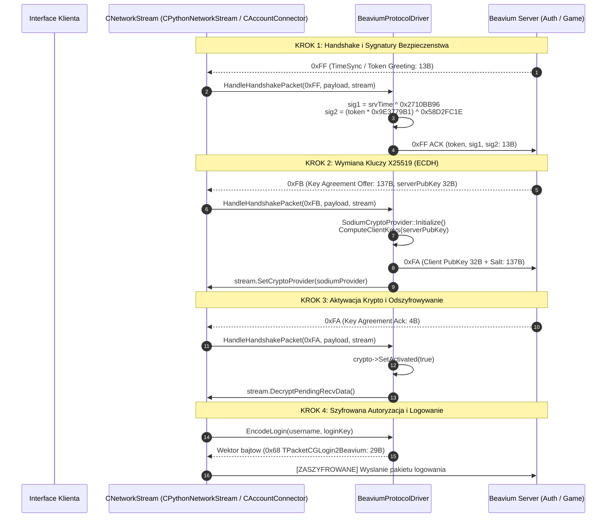

# Specyfikacja Protokolu i Bezpieczenstwa: Profil Beavium (BeaviumProtocolDriver & X25519 libsodium)

## 1. Cel Architektoniczny i Rola Profilu

Profil serwerowy `beavium` stanowi implementacje dedykowanego sterownika protokolu w ramach **Universal Protocol Matrix (UPM)** dla nowoczesnego klienta Metin2 C++23 x64 (`E:\m2dev-client-src-mainOryginalx64`). Profil ten zapewnia obsluge serwerow rodziny Beavium w oparciu o czysty wzorzec **Driver / Strategy Pattern**, bez zanieczyszczania rdzenia silnika gry specyficznym kodem tego serwera.

Glowne parametry i wlasciwosci profilu Beavium:
- **Ramkowanie pakietow TCP ($O(1)$)**: 1-bajtowy naglowek pakietu (`uint8_t`) z deterministycznym wyznaczaniem dlugosci przez tablice 48 pakietow [`beavium_gc_table.inl`](file:///E:/m2dev-client-src-mainOryginalx64/src/Client/Network/Protocol/Generated/beavium_gc_table.inl).
- **Procedura Handshake 0xFF z Sygnaturami Czasu i Tokena**:
  * Odbior pakietu powitalnego `0xFF` (`TPacketGCHandshakeBeavium`: 13B, `srvTime`, `token`).
  * Wyliczanie sygnatur bezpieczenstwa:
    $$\text{sig1} = \text{srvTime} \oplus \text{0x2710BB96}$$
    $$\text{sig2} = (\text{token} \times \text{0x9E3779B1}) \oplus \text{0x58D2FC1E}$$
  * Natychmiastowe odeslanie `TPacketCGHandshakeAckBeavium` (13B).
- **Wymiana Kluczy X25519 Elliptic Curve Diffie-Hellman (ECDH) i SodiumCryptoProvider**:
  * Oferta serwera `0xFB` (`KEY_AGREEMENT_OFFER`, 137B): 32B klucz publiczny serwera + 32B nonce / sol.
  * Generowanie pary kluczy Curve25519 po stronie klienta (`libsodium`).
  * Wyliczenie wspoldzielonego sekretu sesyjnego i odeslanie odpowiedzi `0xFA` (`KEY_AGREEMENT`, 137B).
  * Potwierdzenie `0xFA` (`KEY_AGREEMENT_ACK`, 4B) i aktywacja [`SodiumCryptoProvider`](file:///E:/m2dev-client-src-mainOryginalx64/src/EterLib/SodiumCryptoProvider.h) na strumieniu TCP.
  * Dostawca `SodiumCryptoProvider` implementuje interfejs `INetCryptoProvider` i wrapuje modul `SecureCipher` (libsodium / XChaCha20-Poly1305), zabezpieczajac kanaly TX i RX osobnymi muteksami.
- **Specyficzny Format Pakietow Wychodzacych (CG)**:
  * `EncodeMove`: 29B z rotacja w mikrostopniach ($fRot \times 10^6$) oraz czasem w milisekundach.
  * `EncodeAttack`: 8B (`header` 0x02, `attackType`, `targetVid`, bajty CRC).
  * `EncodeLogin`: 29B (`header` 0x68, nazwa uzytkownika, `dwLoginKey`, 16B klucz klienta).
  * `EncodeAuthLogin`: standardowy naglowek autoryzacyjny `0x6F`.

---

## 2. Diagram Przeplywu Danych i Negocjacji Szyfrowania (Mermaid)



---

## 3. Plik Konfiguracyjny Profilu (`servers/beavium.json`)

```json
{
  "name": "Beavium",
  "version": "1.0.0",
  "driver": "beavium",
  "host": "127.0.0.1",
  "port": 11000,
  "auth": {
    "ip": "127.0.0.1",
    "port": 11000
  },
  "channels": [
    {
      "id": 1,
      "name": "CH1",
      "ip": "127.0.0.1",
      "port": 11011
    },
    {
      "id": 2,
      "name": "CH2",
      "ip": "127.0.0.1",
      "port": 11021
    }
  ],
  "protocol": {
    "framing": "Ymir1B",
    "headerSizeBytes": 1,
    "crypto": "Sodium",
    "keySize": 32,
    "requireCrcPiece": true,
    "magicByte": 255
  },
  "timing": {
    "moveIntervalMs": 150,
    "attackIntervalMs": 380,
    "pickupIntervalMs": 200,
    "pingIntervalMs": 5000,
    "jitterStdDevMs": 15
  },
  "opcodes": {
    "HANDSHAKE": 255,
    "TIME_SYNC": 255,
    "PHASE": 253,
    "PONG": 252,
    "ATTACK": 2,
    "ATTACK_ALT": 29,
    "MOVE": 7,
    "USE_ITEM": 12,
    "DROP_ITEM": 20,
    "PICKUP_ITEM": 14,
    "CHAT": 3,
    "WHISPER": 25,
    "EXCHANGE": 31,
    "SHOP": 27,
    "TARGET": 34,
    "USE_SKILL": 52,
    "SELECT_EMPIRE": 53,
    "KEY_AGREEMENT": 250
  }
}
```

---

## 4. Weryfikacja i Testy Jednostkowe

Implementacja sterownika Beavium objeta jest pelnym zestawem testow automatycznych:
- `test_c31_beavium_server_profile.cpp`: Sprawdza parsowanie konfiguracji JSON, rejestracje w `ServerProfileManager` oraz zgodnosc pol kryptograficznych i formatow ramkowania.
- `test_c34_universal_protocol_drivers.cpp`: Testuje polimorficzna dyspozycje sterownika, serializacje komend `EncodeAttack`, `EncodeMove` (skalowanie mikrostopni), `EncodeLogin` oraz procedure powitania.
- `test_c35_crypto_providers.cpp`: Weryfikuje dzialanie `SodiumCryptoProvider` na symulowanym strumieniu pakietow.
