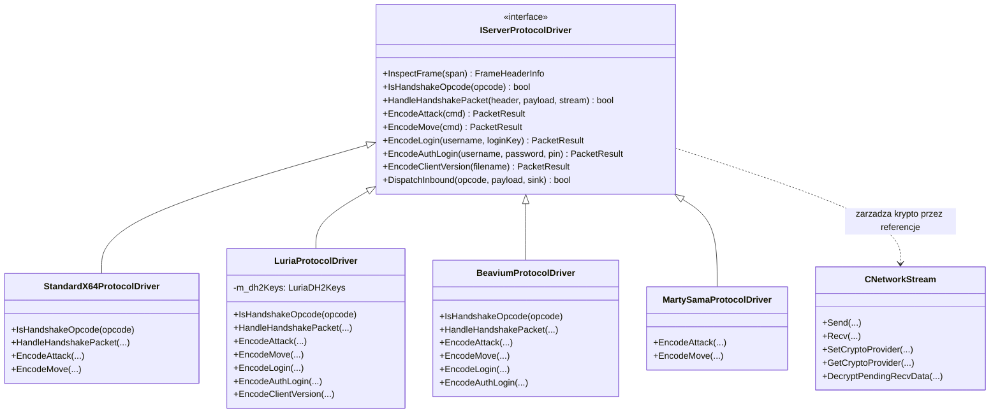

# Architektura Wieloserwerowa: Wzorzec Driver / Strategy Pattern (UPM v2)

## 1. Wprowadzenie i Problem Architektoniczny

We wczesnych wersjach klienta gry obsluga nietypowych serwerow (np. Luria, Beavium) byla realizowana poprzez bezposrednie warunki w glownych modulach transportowych:
```cpp
// ANTY-WZORZEC (Przed refaktoryzacja):
if (pDriver && pDriver->GetDriverName() == "luria")
{
    // reczne kodowanie TPacketCGLogin2Luria
}
else if (pDriver && pDriver->GetDriverName() == "beavium")
{
    // reczne kodowanie TPacketCGLogin2Beavium
}
else
{
    // domyslny standard x64
}
```
Podejscie to naruszalo zasade **Open/Closed Principle (SOLID)**: kazde dodanie kolejnego profilu serwerowego wymagalo edycji newralgicznych plikow rdzenia (`PythonNetworkStream.cpp`, `PythonNetworkStreamPhaseLogin.cpp`, `PythonNetworkStreamPhaseGame.cpp`, `AccountConnector.cpp`), stwarzajac ryzyko regresji dla pozostalych platform.

---

## 2. Architektura Docelowa (Driver / Strategy Pattern)

W ramach refaktoryzacji Universal Protocol Matrix (UPM v2) kluczowe komponenty logiki powiazanej z konkretnym serwerem (kodowanie pakietow wychodzacych, weryfikacja dlugosci ramek, negocjacja handshake oraz przelaczanie kryptografii) zostaly zhermetyzowane w dedykowanych klasach sterownikow implementujacych interfejs [`IServerProtocolDriver`](file:///E:/m2dev-client-src-mainOryginalx64/src/Client/Network/Protocol/IServerProtocolDriver.h), znaczaco redukujac rozproszenie kodu w rdzeniu silnika.

### Diagram Relacji Klas:



---

## 3. Nowe Metody Polimorficzne w `IServerProtocolDriver`

1. **`IsHandshakeOpcode(uint16_t opcode)`**:
   Informuje warstwe transportowa, czy dany pakiet GC nalezy do procedury negocjacji polaczenia / kluczy dla tego sterownika:
   * Dla `StandardX64`: `KEY_CHALLENGE` (0x0B), `KEY_COMPLETE` (0x0C).
   * Dla `Luria`: `HANDSHAKE` (0xFF), `KEY_AGREEMENT` (0xFB), `KEY_AGREEMENT_ACK` (0xFA).
   * Dla `Beavium`: `TIME_SYNC` (0xFF), `KEY_AGREEMENT_OFFER` (0xFB), `KEY_AGREEMENT_ACK` (0xFA).

2. **`HandleHandshakePacket(uint16_t header, std::span<const uint8_t> payload, CNetworkStream& stream)`**:
   Zarzadza cala sekwencja handshaku. Sterownik sam odczytuje parametry powitania, oblicza sygnatury, generuje klucze sesyjne (np. X25519 dla Beavium, DH2 dla Luria), odsyla pakiet odpowiedzi oraz konfiguruje dostawce kryptograficznego (`stream.SetCryptoProvider(...)`).

3. **`EncodeLogin(const std::string& username, uint32_t loginKey)`**:
   Formatuje binarny pakiet wejscia do fazy wyboru postaci (Phase Login -> Select).

4. **`EncodeAuthLogin(const std::string& username, const std::string& password, const std::string& pin)`**:
   Formatuje pakiet autoryzacji do serwera logowania (Phase Handshake -> Auth).

5. **`EncodeClientVersion(const std::string& filename)`**:
   Formatuje pakiet raportu wersji klienta (w Luria: 67B `TPacketCGClientVersionLuria` + `0x0A`, w standardzie: `TPacketCGClientVersion`).

---

## 4. Oczyszczony Przeplyw w Warstwie Transportowej

W [`CPythonNetworkStream::DispatchPacket`](file:///E:/m2dev-client-src-mainOryginalx64/src/UserInterface/PythonNetworkStream.cpp) oraz [`CAccountConnector::__HandshakeState_Process`](file:///E:/m2dev-client-src-mainOryginalx64/src/UserInterface/AccountConnector.cpp) kod sprawdza jedynie:
```cpp
if (pDriver && pDriver->IsHandshakeOpcode(header))
{
    std::vector<uint8_t> packetBuffer(frame.packetLength);
    if (!Recv(frame.packetLength, packetBuffer.data()))
        return false;

    LogRecvPacket(header, frame.packetLength);
    std::span<const uint8_t> packetSpan(packetBuffer.data(), packetBuffer.size());
    return pDriver->HandleHandshakePacket(header, packetSpan, *this);
}
```
Zadna klasa bazowa silnika nie przechowuje juz struktur kryptograficznych specyficznych dla pojedynczego serwera, a dodanie kolejnego profilu (np. dla nowego prywatnego serwera) sprowadza sie wylacznie do utworzenia nowej klasy `NewServerProtocolDriver : public IServerProtocolDriver` i zarejestrowania jej w `ProtocolDriverRegistry`.

---

## 5. Pozostale elementy legacy

Mimo wdrozenia wzorca Driver / Strategy Pattern, proces pelnej migracji nie wyeliminowal jeszcze wszystkich zaleznosci specyficznych dla konkretnych serwerow w klasach klienta. W pliku [`AccountConnector.cpp`](file:///E:/m2dev-client-src-mainOryginalx64/src/UserInterface/AccountConnector.cpp):
- Metoda `__HandshakeState_Process` (linie ~126-138) nadal zawiera bezposredni warunek `if (pDriver && pDriver->GetDriverName() == "luria")` do rozroznienia obslugi pakietu fazy `Luria::GC::PHASE` (2B) od standardowego `GC::PHASE` oraz `GC::PING`.
- Metoda `__AuthState_Process` (linie ~148-160) zawiera warunek `if (pDriver && pDriver->GetDriverName() == "luria")` do procesowania specyficznych pakietow autoryzacji Luria (`Luria::GC::PHASE`, `Luria::GC::AUTH_SUCCESS`, `Luria::GC::LOGIN_FAILURE`).

Miejsca te stanowia cel nastepnego etapu refaktoryzacji, w ktorym zarowno analiza przejscia faz jak i interpretacja odpowiedzi logowania zostana oddelegowane bezposrednio do interfejsu sterownika protokolu.
