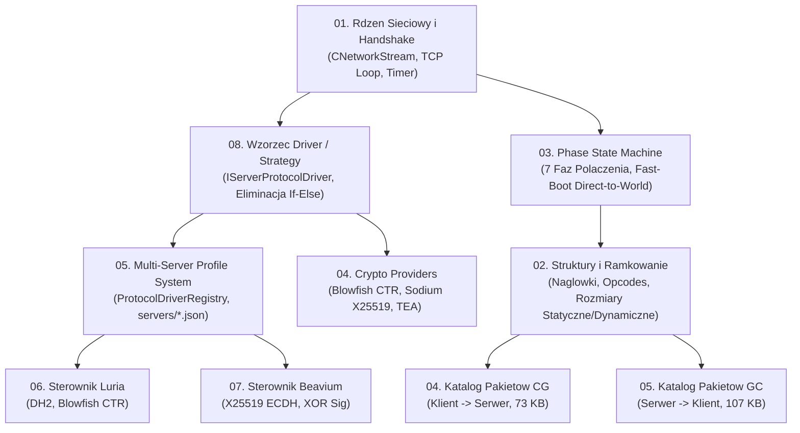

# PAKIET DOKUMENTACJI PROTOKOLU SIECIOWEGO I STEROWNIKOW (UPM v2)

Ten katalog stanowi centralny leksykon wiedzy sieciowej klienta C++23 dla architektury **Universal Protocol Matrix v2 (UPM v2)**.
Zawiera zarowno wysokopoziomowe specyfikacje architektoniczne wzorcow projektowych, jak i niskopoziomowe tablice bajtowe pakietow.

---

## 1. Przewodnik Nawigacyjny po Dokumentacji

---

## 2. Wykaz i Opis Dokumentow w Katalogu

### A. Architektura Silnika Sieciowego i Sterownikow
1. [`01_network_stream_core_handshake.md`](file:///E:/m2dev-client-src-mainOryginalx64/docs/03_network_protocol/01_network_stream_core_handshake.md)
   - Niskopoziomowy transport TCP ([`CNetworkStream`](file:///E:/m2dev-client-src-mainOryginalx64/src/EterLib/NetStream.h)), kolowy bufor pakietow, synchronizacja czasu zegarem `ELTimer` oraz polimorficzny handshake delegowany do aktywnego sterownika.
2. [`08_universal_protocol_drivers_strategy.md`](file:///E:/m2dev-client-src-mainOryginalx64/docs/03_network_protocol/08_universal_protocol_drivers_strategy.md)
   - Manifest wzorca Driver / Strategy. Hermetyzacja logiki serwerowej w dedykowanych klasach ([`IServerProtocolDriver`](file:///E:/m2dev-client-src-mainOryginalx64/src/Client/Network/Protocol/IServerProtocolDriver.h)), wyeliminowanie drabinek warunkowych z `CPythonNetworkStream`.
3. [`05_multi_server_profile_system.md`](file:///E:/m2dev-client-src-mainOryginalx64/docs/03_network_protocol/05_multi_server_profile_system.md)
   - Rejestr sterownikow [`ProtocolDriverRegistry`](file:///E:/m2dev-client-src-mainOryginalx64/src/Client/Network/Protocol/ProtocolDriverRegistry.h), obsluga 4 profili wbudowanych (`standard_x64`, `martysama`, `luria`, `beavium`), konfiguracja z plikow JSON w katalogu `servers/`.
4. [`04_crypto_providers_xor_bf_sodium.md`](file:///E:/m2dev-client-src-mainOryginalx64/docs/03_network_protocol/04_crypto_providers_xor_bf_sodium.md)
   - Interfejs [`INetCryptoProvider`](file:///E:/m2dev-client-src-mainOryginalx64/src/EterLib/NetCryptoProvider.h) oraz 3 wymienne implementacje: Blowfish CTR ([`BlowfishCryptoProvider`](file:///E:/m2dev-client-src-mainOryginalx64/src/EterLib/BlowfishCryptoProvider.h)), LibSodium XChaCha20-Poly1305 ([`SodiumCryptoProvider`](file:///E:/m2dev-client-src-mainOryginalx64/src/EterLib/SodiumCryptoProvider.h)) oraz klasyczny TEA ([`TeaModern.h`](file:///E:/m2dev-client-src-mainOryginalx64/src/EterBase/TeaModern.h)).

### B. Maszyna Stanow Faz i Ramkowanie
5. [`03_phase_state_machine.md`](file:///E:/m2dev-client-src-mainOryginalx64/docs/03_network_protocol/03_phase_state_machine.md)
   - Automat 7 faz polaczenia (`EPhase`), rejestracja tabelaryczna handlerow oraz nakladka Fast-Boot Direct-to-World ([`FastBootOverlay`](file:///E:/m2dev-client-src-mainOryginalx64/src/UserInterface/FastBootOverlay.h)) pomijajaca powolne ekrany Pythona.
6. [`09_fastboot_loading_to_game_pipeline.md`](file:///E:/m2dev-client-src-mainOryginalx64/docs/03_network_protocol/09_fastboot_loading_to_game_pipeline.md)
   - Architektura Fast-Boot Direct-to-World, podzial zadan C++ vs Python, oraz analiza przyczyn braku modeli 3D i HUD (Terrain-Only + Chat Root Cause Analysis).
7. [`02_packet_structures_opcodes.md`](file:///E:/m2dev-client-src-mainOryginalx64/docs/03_network_protocol/02_packet_structures_opcodes.md)
   - Nowoczesny opis struktur ramkowania: naglowki statyczne vs dynamiczne, metoda `InspectFrame` oraz tabele inspekcji `luria_gc_table.inl` (139 wpisow) i `beavium_gc_table.inl` (48 wpisow).
8. [`02_phases_login_select_loading.md`](file:///E:/m2dev-client-src-mainOryginalx64/docs/03_network_protocol/02_phases_login_select_loading.md)
   - Szczegolowy opis sekwencji pakietow logowania konta, autoryzacji PIN/HWID, zapytania o imperium oraz wczytywania krainy gry.
9. [`03_phase_game_actors_items.md`](file:///E:/m2dev-client-src-mainOryginalx64/docs/03_network_protocol/03_phase_game_actors_items.md)
   - Szczegolowa specyfikacja wymiany pakietow fazy gry: tworzenie bytow na mapie, synchronizacja ruchu, ekwipunek i handel.

### C. Dedykowane Profile Serwerowe
9. [`06_luria_protocol_driver_dh2.md`](file:///E:/m2dev-client-src-mainOryginalx64/docs/03_network_protocol/06_luria_protocol_driver_dh2.md)
   - Profil Luria: akceleracja kryptograficzna DH2 MODP 1024-bit ([`LuriaDH2`](file:///E:/m2dev-client-src-mainOryginalx64/src/Client/Network/Protocol/LuriaDH2.h)), Blowfish CTR, dedykowana autoryzacja 168B oraz tablica opkodow GC z `luria_gc_table.inl`.
10. [`07_beavium_protocol_driver_x25519.md`](file:///E:/m2dev-client-src-mainOryginalx64/docs/03_network_protocol/07_beavium_protocol_driver_x25519.md)
   - Profil Beavium: handshake z sygnaturami XOR (token, czas serwera), klucze sesji X25519 ECDH w ramkach 137B (`0xFB`/`0xFA`), szyfrowanie Sodium oraz rotacja postaci w mikrostopniach ($fRot \times 10^6$).

### D. Glebokie Katalogi Pakietow (Deep Packet Catalogues)
11. [`04_packets_cg_client_to_server.md`](file:///E:/m2dev-client-src-mainOryginalx64/docs/03_network_protocol/04_packets_cg_client_to_server.md)
   - Kompletny, 73-kilobajtowy katalog kazdego pakietu wychodzacego od klienta do serwera (format binarny, pola, offsety pamieciowe).
12. [`05_packets_gc_server_to_client.md`](file:///E:/m2dev-client-src-mainOryginalx64/docs/03_network_protocol/05_packets_gc_server_to_client.md)
   - Kompletny, 107-kilobajtowy katalog kazdego pakietu przychodzacego z serwera do klienta (formaty statyczne, dynamiczne, zagnjezdzone struktury atrybutow).

---

## 3. Zasady Dobrej Praktyki dla Agentow AI
- Nigdy nie dodawaj nazw serwerow (`"beavium"`, `"luria"`) bezposrednio do rdzenia silnika transportowego (`CNetworkStream`, `CPythonNetworkStream`).
- Wszystkie rozszerzenia logiki specyficznej dla serwera nalezy implementowac jako metody klasy pochodnej od [`IServerProtocolDriver`](file:///E:/m2dev-client-src-mainOryginalx64/src/Client/Network/Protocol/IServerProtocolDriver.h).
- Nowe pakiety nalezy rejestrowac w tabelach inspekcji ramki danego profilu (`*_gc_table.inl`).
