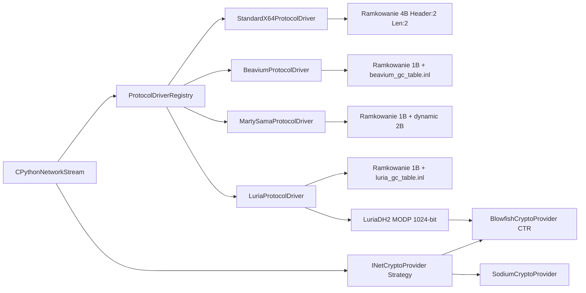

# Kompendium Klienta: Nowoczesna Centralna Mapa Systemu (CLIENT_SYSTEM_MAP 2026)

## 1. Cel Architektoniczny i Rola Modulu

Centralna Mapa Systemu definiuje zintegrowana architekture natywnego silnika klienta gry C++23 (`E:\m2dev-client-src-mainOryginalx64`) po pelnej dekonstrukcji historycznych monolitow kodu z lat 2004-2014. Klient operuje wedlug wzorca **AI-First Architecture** oraz **Data-Oriented Design (DOD)**:

- **Jedyny Silnik Klienta (Native C++23)**: Klient to wylacznie skompilowany plik [`Metin2_Release.exe`](file:///E:/m2dev-client-src-mainOryginalx64/build/bin/Release/Metin2_Release.exe) (29.5 MB) zlinkowany z biblioteka [`Client2026.lib`](file:///E:/m2dev-client-src-mainOryginalx64/build/src/Client/Release/Client2026.lib). Zarzucony prototyp w Pure Rust zostal w pelni zastapiony przez natywny silnik C++23 z mostkiem IPC Named Pipe i serwerem MCP `m2-client-test`.
- **Single Source of Truth**: Eliminacja globalnych zmutowanych buforow na rzecz domen [`WorldContext`](file:///E:/m2dev-client-src-mainOryginalx64/src/Client/Core/WorldContext.h), [`InventoryDomain`](file:///E:/m2dev-client-src-mainOryginalx64/src/Client/Gameplay/InventoryDomain.h), [`SkillDomain`](file:///E:/m2dev-client-src-mainOryginalx64/src/Client/Gameplay/SkillDomain.h) i [`PlayerStatsDomain`](file:///E:/m2dev-client-src-mainOryginalx64/src/Client/Gameplay/PlayerStatsDomain.h).
- **Zbalansowane SRP (150-450 linii)**: Brak gigantycznych monolitow i brak antywzorca mikro-plikow (<50 linii).
- **Zero-Copy & Zero-Alloc**: Nowoczesny dispatch tablicowy $O(1)$ w [`ModernPacketDispatcher`](file:///E:/m2dev-client-src-mainOryginalx64/src/Client/Network/ModernPacketDispatcher.h) z buforowaniem zero-copy (`std::span<const uint8_t>`).
- **Memory Safety & ABA Prevention**: Generacyjny rejestr encji [`GenerationalRegistry`](file:///E:/m2dev-client-src-mainOryginalx64/src/Client/Actor/EntityHandle.h) oraz bezpieczny rejestr funkcyjny [`ActorRegistry`](file:///E:/m2dev-client-src-mainOryginalx64/src/Client/World/ActorRegistry.h) eliminujacy wiszace wskazniki i Use-After-Free.

---

## 2. Diagram Architektury Systemu (C++23 AI-First)

```mermaid
graph TD
    %% Glowny punkt wejscia
    WinMain[WinMain / UserInterface.cpp] --> AppInit[CPythonApplication::Initialize]
    WinMain --> MainLoop[Main Message Loop]
    MainLoop --> AppUpdate[CPythonApplication::Update]
    MainLoop --> AppRender[CPythonApplication::Render]
    
    %% Warstwa domenowa
    AppInit --> WorldCtx[Client::Core::WorldContext]
    WorldCtx --> InvDomain[InventoryDomain]
    WorldCtx --> SkillDomain[SkillDomain]
    WorldCtx --> StatsDomain[PlayerStatsDomain]
    WorldCtx --> ActorReg[ActorRegistry & SpatialHashGrid]
    
    %% Warstwa sieciowa
    AppUpdate --> NetDispatcher[ModernPacketDispatcher O(1)]
    NetDispatcher --> NetHandlers[117 Handlerow SRP + 4 Domeny Podsystemowe]
    NetHandlers --> NetEvents[Core::EventBus]
    NetEvents --> WorldCtx
    
    %% Mostek Pythona C-API
    AppInit --> PyPlayerModule[PythonPlayerModule Spis Tresci]
    PyPlayerModule --> PyInv[PythonPlayerModule_Inventory]
    PyPlayerModule --> PyCombat[PythonPlayerModule_Combat]
    PyPlayerModule --> PySkills[PythonPlayerModule_Skills]
    PyPlayerModule --> PyMove[PythonPlayerModule_Movement]
    
    %% Cykl zycia postaci
    AppUpdate --> InstanceBase[CInstanceBase Core]
    InstanceBase --> StranglerFacade[StranglerInstanceFacade]
    InstanceBase --> Appearance[InstanceBaseAppearance]
    InstanceBase --> Mount[InstanceBaseMount]
    StranglerFacade --> GenerationalReg[GenerationalRegistry O(1)]
    StranglerFacade --> ActorReg

    %% Potok Diagnostyczny Renderera (ESP & Debug)
    AppRender --> DebugGuard[ScopedDebugRenderGuard RAII]
    DebugGuard --> DebugRHI[DebugRenderer::Render D3D9]
    DebugRHI --> NormalBatch[Standard Primitive Batch Z-Enable]
    DebugRHI --> XRayBatch[X-Ray Primitive Batch No-Z]
    AppInit --> PyDebugBridge[debugRender Python C-API]
    PyDebugBridge -.-> DebugRHI

    %% IPC i Serwer Testowy
    AppUpdate --> PipeQueue[TestHarnessServer::ProcessMainThreadQueue]
    PipeQueue --> HarnessServer[TestHarnessServer Win32 Named Pipe]
    HarnessServer <--> MCPServer[m2_agent_harness_mcp.py 38 Narzedzi MCP]
```

---

## 3. Zdekonstruowane Monolity i Nowe Domeny

| Podsystem | Stan Pierwotny (Legacy) | Stan Zdekonstruowany (C++23 AI-First) | Kluczowe Klasy i Pliki |
|---|---|---|---|
| **Monolit Sieciowy** | `PythonNetworkStreamPhaseGame.cpp` (10 713 linii) | Tablicowy dispatch $O(1)$, zero-copy framing, handlery SRP | [`ModernPacketDispatcher.h`](file:///E:/m2dev-client-src-mainOryginalx64/src/Client/Network/ModernPacketDispatcher.h), [`PartyPacketDomainHandler`](file:///E:/m2dev-client-src-mainOryginalx64/src/Client/Network/Handlers/PartyPacketDomainHandler.h), [`GuildPacketDomainHandler`](file:///E:/m2dev-client-src-mainOryginalx64/src/Client/Network/Handlers/GuildPacketDomainHandler.h), [`QuestDialogDomainHandler`](file:///E:/m2dev-client-src-mainOryginalx64/src/Client/Network/Handlers/QuestDialogDomainHandler.h), [`RefineExchangeDomainHandler`](file:///E:/m2dev-client-src-mainOryginalx64/src/Client/Network/Handlers/RefineExchangeDomainHandler.h) |
| **Monolit Gracza** | `PythonPlayer.cpp` (7 523 linie, `m_playerStatus`) | Domeny DDD, silne typowanie (StrongTypes), brak singletonu | [`InventoryDomain.h`](file:///E:/m2dev-client-src-mainOryginalx64/src/Client/Gameplay/InventoryDomain.h), [`SkillDomain.h`](file:///E:/m2dev-client-src-mainOryginalx64/src/Client/Gameplay/SkillDomain.h), [`PlayerStatsDomain.h`](file:///E:/m2dev-client-src-mainOryginalx64/src/Client/Gameplay/PlayerStatsDomain.h), [`WorldContext.h`](file:///E:/m2dev-client-src-mainOryginalx64/src/Client/Core/WorldContext.h) |
| **Monolit Aktora** | `InstanceBase.cpp` (5 732 linie, raw pointers) | Kompozycyjne komponenty (`InstanceMountComponent`, `InstanceCombatComponent`), Strangler Facade, GenerationalRegistry, SoA ECS | [`StranglerInstanceFacade.h`](file:///E:/m2dev-client-src-mainOryginalx64/src/Client/Bridge/StranglerInstanceFacade.h), [`InstanceMountComponent.h`](file:///E:/m2dev-client-src-mainOryginalx64/src/UserInterface/InstanceComponents/InstanceMountComponent.h), [`InstanceCombatComponent.h`](file:///E:/m2dev-client-src-mainOryginalx64/src/UserInterface/InstanceComponents/InstanceCombatComponent.h), [`ActorRegistry.h`](file:///E:/m2dev-client-src-mainOryginalx64/src/Client/World/ActorRegistry.h) |
| **Zarzadzanie Cyklem Zycia** | Multi-State (6 niezaleznych map w `PythonCharacterManager`) | Single Source of Truth (`m_subsystemActorRegistry`) + atomowe metody centralne | [`PythonCharacterManager.h`](file:///E:/m2dev-client-src-mainOryginalx64/src/UserInterface/PythonCharacterManager.h), `CentralRegisterActor`, `CentralUnregisterActor`, `CentralUpdateActorPosition`, `CentralClearActors` |
| **Maszyna Stanow D3D9** | Wycieki stanow FVF/VertexDeclaration/Shaderow w D3D9 | Modul straznikow RAII, hermetyczne czyszczenie FFP w terenie, defensywny StateManager | [`StateManagerGuards.h`](file:///E:/m2dev-client-src-mainOryginalx64/src/EterLib/StateManagerGuards.h), [`StateManager.h`](file:///E:/m2dev-client-src-mainOryginalx64/src/EterLib/StateManager.h), `ScopedD3DFFPGuard`, `ScopedD3DVertexDeclGuard` |
| **Struktury Protokolu** | `Protocol.h` (2 039 linii, monolit) | Fasada 19 linii + 5 odizolowanych naglowkow domenowych | [`Protocol_Common.h`](file:///E:/m2dev-client-src-mainOryginalx64/src/Client/Network/Protocol/Protocol_Common.h), [`Protocol_Player.h`](file:///E:/m2dev-client-src-mainOryginalx64/src/Client/Network/Protocol/Protocol_Player.h), [`Protocol_Item.h`](file:///E:/m2dev-client-src-mainOryginalx64/src/Client/Network/Protocol/Protocol_Item.h), [`Protocol_Combat.h`](file:///E:/m2dev-client-src-mainOryginalx64/src/Client/Network/Protocol/Protocol_Combat.h), [`Protocol_GuildParty.h`](file:///E:/m2dev-client-src-mainOryginalx64/src/Client/Network/Protocol/Protocol_GuildParty.h) |
| **Bindingi Pythona C-API** | `PythonPlayerModule.cpp` (2 592 linie, 130 funkcji) | Podzial na 4 domeny SRP + glowny rejestr method table | [`PythonPlayerModule_Inventory.cpp`](file:///E:/m2dev-client-src-mainOryginalx64/src/UserInterface/PythonPlayerModule_Inventory.cpp), [`PythonPlayerModule_Combat.cpp`](file:///E:/m2dev-client-src-mainOryginalx64/src/UserInterface/PythonPlayerModule_Combat.cpp), [`PythonPlayerModule_Skills.cpp`](file:///E:/m2dev-client-src-mainOryginalx64/src/UserInterface/PythonPlayerModule_Skills.cpp), [`PythonPlayerModule_Movement.cpp`](file:///E:/m2dev-client-src-mainOryginalx64/src/UserInterface/PythonPlayerModule_Movement.cpp) |
| **Renderer Diagnostyczny & ESP** | Brak mozliwosci rysowania wektorowego 3D bez hackowania | Fasada RHI `DebugRenderer`, straznik RAII `ScopedDebugRenderGuard`, mostek `debugRender` (WorldToScreen, tracery, boxy, AABB, okregi, radar) | [`DebugRenderer.h`](file:///E:/m2dev-client-src-mainOryginalx64/src/Client/Graphics/Debug/DebugRenderer.h), [`PythonDebugRenderModule.cpp`](file:///E:/m2dev-client-src-mainOryginalx64/src/UserInterface/PythonDebugRenderModule.cpp), [`ScopedDebugRenderGuard`](file:///E:/m2dev-client-src-mainOryginalx64/src/EterLib/StateManagerGuards.h) |
| **Fast-Boot & Direct-to-World** | Wolne introLogin, VirtualKeyboard, 13 klatek ladowania | Natywny Dear ImGui DX9, pominiecie Pythona, sub-second boot, DirectEnter | [`FastBootOverlay.h`](file:///E:/m2dev-client-src-mainOryginalx64/src/UserInterface/FastBootOverlay.h), [`FastBootOverlay.cpp`](file:///E:/m2dev-client-src-mainOryginalx64/src/UserInterface/FastBootOverlay.cpp), [`FAST_BOOT_DIRECT_TO_WORLD_MANUAL.md`](file:///E:/m2dev-client-src-mainOryginalx64/docs/FAST_BOOT_DIRECT_TO_WORLD_MANUAL.md) |
| **Wysylanie Pakietow (Senders)** | 46 rozproszonych mikro-plikow .cpp/.h (Send*Packet) | Skonsolidowany modul domenowy SRP | [`GamePacketSenders.h`](file:///E:/m2dev-client-src-mainOryginalx64/src/UserInterface/Network/Senders/GamePacketSenders.h), [`GamePacketSenders.cpp`](file:///E:/m2dev-client-src-mainOryginalx64/src/UserInterface/Network/Senders/GamePacketSenders.cpp) |
| **Kontrolery Instancji** | 44 mikro-pliki (Instance*_Clear.cpp, wydmuszka Rank) | 6 logicznych modulow domenowych SRP | `InstanceAnimationControllers`, `InstanceEffectControllers`, `InstanceEquipmentControllers`, `InstanceMountControllers`, `InstanceTitleRankControllers`, `InstanceSoundControllers` |
| **Virtual File System (VFS)** | 90 zahardcodowanych nazw paczek w C++ | Dynamiczny Data-Driven VFS (`std::filesystem::directory_iterator`) | [`UserInterface.cpp`](file:///E:/m2dev-client-src-mainOryginalx64/src/UserInterface/UserInterface.cpp), automatyczne montowanie `.pck`, Zero Race Condition |
| **Faza Gry Metody Rzadkie** | Monolit `PythonNetworkStreamPhaseGame.cpp` | Wydzielony modul procedur sieciowych | [`PythonNetworkStreamPhaseGameMisc.h`](file:///E:/m2dev-client-src-mainOryginalx64/src/UserInterface/PythonNetworkStreamPhaseGameMisc.h), [`PythonNetworkStreamPhaseGameMisc.cpp`](file:///E:/m2dev-client-src-mainOryginalx64/src/UserInterface/PythonNetworkStreamPhaseGameMisc.cpp) |
| **Fundamenty EterBase** | Zdublowane loggery, pliki-wydmuszki `Logger.h`, `PacketResult.h` | Czyste, bezposrednie naglowki modern C++23 | [`LogModern.h`](file:///E:/m2dev-client-src-mainOryginalx64/src/EterBase/LogModern.h), [`Result.h`](file:///E:/m2dev-client-src-mainOryginalx64/src/EterBase/Result.h) |

---

## 4. Wytyczne dla Autonomicznych Agentow AI (AI-First Coding Standards)

1. **Budzet pliku i SRP**: Nowe moduly implementacyjne musza realizowac scisla zasade pojedynczej odpowiedzialnosci (Single Responsibility Principle) o naturalnej wielkosci podsystemu do **1500 linii kodu** (dla zlozonych monolitow domenowych do 3000 linii). ZABRANIA SIE sztucznego rozbijania kodu na mikro-pliki ponizej 50 linii.
2. **Typowanie**: Zamiast surowych typow calkowitych (`DWORD`, `int`) nalezy bezwzglednie stosowac silne typy domenowe z [`StrongTypes.h`](file:///E:/m2dev-client-src-mainOryginalx64/src/EterBase/StrongTypes.h): `EntityVid`, `ItemVnum`, `SlotIndex`, `Money64`.
3. **Zarzadzanie encjami**: Zamiast bezposrednich wskaznikow `CInstanceBase*` agenci musza korzystac z uchwytow `EntityHandle`, metod `CPythonCharacterManager::for_each_actor` lub bezpiecznego wzorca funkcyjnego `ActorRegistry::VisitActor(vid, visitor)`.
4. **Maszyna stanow D3D9**: Kazda operacja modyfikujaca stany renderowania, samplery, shadery lub deklaracje wierzcholkow w Direct3D 9 musi byc bezwzglednie hermetyzowana za pomoca obiektow RAII z [`StateManagerGuards.h`](file:///E:/m2dev-client-src-mainOryginalx64/src/EterLib/StateManagerGuards.h).
5. **Weryfikacja**: Kazda zmiana musi zostac zweryfikowana uruchomieniem testow CTest (`ctest -C Release`). Wszystkie 51 testow jednostkowych i integracyjnych (w tym `HeadlessClientLiveTest`) musi miec status PASS (100%).

---

## 5. Zasada Spojnosci Osi Y oraz Direct3D 9 FFP / VertexDeclaration

1. **Spojnosc Osi Y (D3D9 vs Siec i UI)**:
   - W ukladzie Direct3D 9 wspolrzedne swiata maja zanegowana os Y (`-pos.y`).
   - Logika fizyki, UI oraz protokoly sieciowe (`TPacketCGMove`, `TPacketGCCharacterAdd`) operuja na dodatnich wspolrzednych lokalnych siatki mapy `[0, 204800)`.
   - Transformacje miedzy ukladami musza odbywac sie wylacznie przez `CInstanceBase::NEW_SetPixelPosition` oraz `m_GraphicThingInstance.SetCurPixelPosition`. Bezposrednie nadpisywanie `m_actorInstance.SetPixelPosition(pos)` w komponentach jest zabronione, gdyz niszczy znak osi Y i powoduje gumowanie (rubberbanding, `dist: 1873.0m > 25m`) ze strony serwera.

2. **Standard Przeplywu Direct3D 9 FFP (Fixed Function Pipeline)**:
   - Wywolanie `IDirect3DDevice9::SetVertexDeclaration(NULL)` jest w standardzie Direct3D 9 nielegalne i zwraca `D3DERR_INVALIDCALL`.
   - Zgodnie ze specyfikacja Microsoft D3D9, wywolanie `SetFVF(dwFVF)` automatycznie odlacza aktywna deklaracje wierzcholkow na poziomie sprzetowym.
   - Wszelkie przelaczenia miedzy modelami programowalnymi (glTF/Shadery) a Fixed Function Pipeline (teren, interfejs 2D) musza korzystac ze straznikow RAII `ScopedD3DFFPGuard` oraz `CStateManager::SetFVF`.

3. **Izolacja RenderTargetu Cieni**:
   - Wywolania `rkMap.EndRenderCharacterShadowToTexture()` musza byc scisle powiazane z blokiem warunkowym `canRender` po udanym `BeginRenderCharacterShadowToTexture()`.
   - Zapobiega to zerowaniu glownego bufora ramki Direct3D9 (`SetRenderTarget(0, NULL)`), co prowadzilo do utraty bufora ekranu przed narysowaniem terenu.

4. **Legalnosc VirtualID = 0 w Fazie Intro (Wybor i Tworzenie Postaci)**:
   - W menu wyboru (`introSelect.py`) oraz tworzenia postaci (`introCreate.py`) moduly Pythona uzywaja indeksow slotow 0..3 jako unikalnych identyfikatorow lokalnych instancji aktora (`chr.CreateInstance(0)`, `chr.SelectInstance(0)`).
   - Wartosc `dwVID = 0` (oraz `EntityId(0)`) jest w 100% poprawnym i legalnym identyfikatorem instancji w fazie wyboru postaci oraz w rejestrach ECS.

---

## 6. Nowoczesne Podsystemy Domenowe i Refaktoryzacja

### 1. `ActorRegistry` i `SpatialHashGrid`:
- Przestrzenne indeksowanie bytow ze straznikiem wielowatkowym `std::shared_mutex`.
- Zabezpieczenie przed problemem ABA: nadpisywanie martwych wpisow (Upsert) przy natychmiastowym respawnie potwora pod tym samym VID.
- Ochrona przed atakiem DoS i przeciazeniem: automatyczny fallback $O(N)$ przy skanowaniu promienia przekraczajacym liczbe bytow na mapie lub 500 komorek siatki.
- Natychmiastowa aktualizacja komorki siatki przestrzennej w `NEW_SetPixelPosition` niezaleznie od flagi ruchu.

### 2. Matematyka Ruchu i Katow:
- Zastapienie `acosf(D3DXVec3Dot)` przez `atan2f(x, -y)` we wszystkich modulach kalkulacji wektorow.
- Calkowita eliminacja bledow `NaN` (Domain Error) oraz obrotow o 90 stopni przy odleglosci zerowej.

### 3. Bezpieczenstwo Zdarzen Walki i Luku:
- Handler `CNormalBowAttack_FlyEventHandler_AutoClear` przechowuje silny typ `EntityVid` z weryfikacja istnienia instancji przed emisja pakietu, eliminujac Use-After-Free (UAF).
- Wzorzec Dirty Loop Drain w `CPythonPlayer::__UpdateBattleStatus()` zapobiega cichemu gubieniu aktualizacji statystyk i broni.

---

## 7. Ochrona Danych Rasy i Animacji (RaceData / Motion Safety) oraz Karuzela 3D

1. **Bezwzgledna Ochrona Przed Nullptr w Systemie Animacji (`ActorInstanceMotion.cpp`)**:
   - W kompilacji Release x64 makro `assert(m_pkCurRaceData)` jest zastepowane przez `((void)0)`. W przypadku niezainicjalizowanej instancji postaci proba wywolania `m_pkCurRaceData->GetMotionKey(...)` powoduje natychmiastowy zrzut `EXCEPTION_ACCESS_VIOLATION 0xC0000005` (odczyt adresu `0x00000000000000E0`).
   - Metody `CActorInstance::PushOnceMotion`, `PushLoopMotion`, `GetRandomMotionKey` oraz `__BindMotionData` posiadaja obligatoryjne guardy defensywne `if (!m_pkCurRaceData) return false;`.
   - Podobna ochrona funkcjonuje w detekcji kolizji walki (`ActorInstanceCollisionDetection.cpp`) dla `m_pkCurRaceMotionData` oraz wskaznika `pad`.

2. **Dzialanie Karuzeli Postaci w Menu Wyboru (`introselect.py`)**:
   - Wybor postaci nie korzysta z 4 oddzielnych przyciskow 2D, lecz z dynamicznej karuzeli 3D o promieniu `distance = 50.0` obracajacej sie wokol punktu centralnego `(0, 0, 0)` z katami bazowymi `[135.0, 225.0, 315.0, 45.0]`.
   - Przelaczanie postaci realizowane jest smoczymi przyciskami `left_button` / `right_button` na dole ekranu, strzalkami lewo/prawo lub klawiszami numerycznymi 1, 2, 3, 4.
   - W metodzie `OnUpdate` instancje postaci na karuzeli maja zsynchronizowany kat obrotu `chr.SetRotation(self.curRotation[i] - 135.0)`, dzieki czemu wybrana postac na pierwszym planie stoi zawsze twarza do gracza, a pozostale postacie ustawiaja sie pod naturalnym katem okregu karuzeli.

---

## 8. Nowoczesna Fasada Diagnostyczna Renderera (DebugRenderer & Python debugRender API)

Dla celow testow automatycznych, diagnostyki wizualnej, test harness oraz skryptow pomocniczych/bota wdrozon nowoczesna fasade `DebugRenderer` z pelnym mostkiem C-API do srodowiska Pythona.

### 1. Architektura RHI i Straznik Stanu Direct3D 9 (`ScopedDebugRenderGuard`):
- **Struktura wierzcholka**: [`DebugVertex`](file:///E:/m2dev-client-src-mainOryginalx64/src/Client/Graphics/Debug/DebugVertex.h) (16 bajtow: `float x, y, z; uint32_t color`, FVF: `D3DFVF_XYZ | D3DFVF_DIFFUSE`).
- **Ochrona RAII**: [`ScopedDebugRenderGuard`](file:///E:/m2dev-client-src-mainOryginalx64/src/EterLib/StateManagerGuards.h):
  - Izolacja macierzy swiata: zapisuje i ustawia `D3DTS_WORLD` na tozsamosciowa `D3DXMatrixIdentity`, eliminujac znieksztalcenia po wczesniej renderowanych obiektach gry.
  - Ochrona Z-Buffera: ustawia `D3DRS_ZWRITEENABLE = FALSE` zapobiegajac niszczeniu bufora glebokosci i z-fightingowi.
  - Czysty potok tekstur: odcina etapy `STATEMANAGER.SetTexture(0, NULL)` i `SetTexture(1, NULL)`.
  - W destruktorze: w 100% przywraca oryginalne stany urzadzenia i macierze swiata.
- **Odpornosc na limity sprzetowe (Hardware Chunking)**:
  - W [`DebugRenderer::Render`](file:///E:/m2dev-client-src-mainOryginalx64/src/Client/Graphics/Debug/DebugRenderer.cpp) duze strumienie wierzcholkow sa dzielone na bezpieczne chunki do 4096 linii (8192 wierzcholkow) na wywolanie `DrawPrimitiveUP`, eliminujac ryzyko przekroczenia limitu sterownika GPU.
- **Eliminacja Z-Fightingu dla Okregow**:
  - Generator [`GenerateCircleVertices`](file:///E:/m2dev-client-src-mainOryginalx64/src/Client/Graphics/Debug/DebugRenderPrimitives.h) automatycznie aplikuje bezpieczny lift `cz + 2.5f`, dzieki czemu okregi na ziemi nie migocza ze splattingiem terenu.

### 2. Dostepne Metody Modulu Pythona `debugRender`:
| Metoda Pythona | Parametry | Opis |
|---|---|---|
| `debugRender.DrawLine` | `(x1, y1, z1, x2, y2, z2, color, xray=False)` | Rysuje linie 3D pomiedzy dwoma punktami. |
| `debugRender.DrawTracer` | `(vid, color, xray=True)` | Rysuje linie tracer od pozycji gracza glownego do wskazanego celu VID. |
| `debugRender.DrawBox` | `(vid, color, xray=False)` | Rysuje ramke AABB 3D wokol wskazanego aktora na scenie. |
| `debugRender.DrawAABB` | `(minX, minY, minZ, maxX, maxY, maxZ, color, xray=False)` | Rysuje ramke szescienna AABB w przestrzeni swiata. |
| `debugRender.DrawCircle` | `(cx, cy, cz, radius, color, xray=False, seg=24)` | Rysuje okrag na ziemi w 3D (z zabezpieczeniem przed z-fightingiem). |
| `debugRender.DrawCircleActor` | `(vid, radius, color, xray=False, seg=24)` | Rysuje okrag wokol danego aktora (np. zasieg ataku / aggro). |
| `debugRender.DrawCross` | `(x, y, z, size=50.0, color, xray=False)` | Rysuje krzyzyk 3D (trzy osie) wskazujacy punkt orientacyjny. |
| `debugRender.WorldToScreen` | `(x, y, z)` | Rzutuje punkt 3D swiata na ekran 2D: zwraca krotke `(screenX, screenY, isVisible)`. |
| `debugRender.GetActorScreenPos` | `(vid)` | Zwraca pozycje aktora na ekranie 2D: `(screenX, screenY, isVisible)`. |
| `debugRender.GetActorsInRadius`| `(radius, typeFilter=-1, includeDead=False)` | Blyskawiczne skanowanie otoczenia w C++: zwraca krotke VID-ow pasujacych do kryteriow. |
| `debugRender.Clear` | `()` | Czysci kolejke rysowania z biezacej klatki. |
| `debugRender.GetCounts` | `()` | Zwraca krotke liczby prymitywow `(lines, boxes, circles)`. |
| `debugRender.Enable` | `(True/False)` | Globalnie wlacza lub wylacza renderowanie debugera. |
| `debugRender.IsEnabled` | `()` | Zwraca 1 gdy renderer jest aktywny, 0 gdy wylaczony. |

---

## 9. Uniwersalna Macierz Protokolow (Universal Protocol Matrix - UPM) i Multi-Server Profiles

Klient eliminuje sztywne powiazanie z jednym serwerem dzieki heksagonalnej architekturze sterownikow protokolu:



### 1. Zestawienie Sterownikow Protokolu:
| Profil Sterownika | Typ Ramkowania | Opcodes Nadawcze (CG) | Opcodes Odbiorcze (GC) | Standard Szyfrowania | Pliki Zrodlowe |
|---|---|---|---|---|---|
| **`standard_x64`** | 4-bajtowe `[H:2][L:2]` | Atak: 11B, Ruch: 19B (`uint8_t` bRot) | Tablicowy dispatch $O(1)$ + Ramkowanie x64 4B `[H:2][L:2]` (`TPacketGCMainCharacter` `0x0071`) | SecureCipher / Libsodium | [`StandardX64ProtocolDriver.h`](file:///E:/m2dev-client-src-mainOryginalx64/src/Client/Network/Protocol/Drivers/StandardX64ProtocolDriver.h) |
| **`beavium`** | 1-bajtowe + lookup | Atak: 8B, Ruch: 24B (mikrostopnie) | Lookup w `beavium_gc_table.inl` | AES-256-CTR | [`BeaviumProtocolDriver.h`](file:///E:/m2dev-client-src-mainOryginalx64/src/Client/Network/Protocol/Drivers/BeaviumProtocolDriver.h) |
| **`martysama`** | 1-bajtowe + dynamic 2B | Atak: 9B (CRC MagicCube), Ruch: 24B | Mainline GC table (51B ItemSet) | Standard TEA / Security | [`MartySamaProtocolDriver.h`](file:///E:/m2dev-client-src-mainOryginalx64/src/Client/Network/Protocol/Drivers/MartySamaProtocolDriver.h) |
| **`luria`** | 1-bajtowe + lookup | Atak: 8B (CRC XOR Cube), Ruch: 19B (`float` fRot) | Lookup w `luria_gc_table.inl` (137 pakietow) | Diffie-Hellman DH2 MODP + Blowfish CTR | [`LuriaProtocolDriver.h`](file:///E:/m2dev-client-src-mainOryginalx64/src/Client/Network/Protocol/Drivers/LuriaProtocolDriver.h), [`LuriaDH2.h`](file:///E:/m2dev-client-src-mainOryginalx64/src/Client/Network/Protocol/LuriaDH2.h), [`BlowfishCryptoProvider.h`](file:///E:/m2dev-client-src-mainOryginalx64/src/EterLib/BlowfishCryptoProvider.h) |

### 2. Architektura Pluggable Crypto Strategy:
Interfejs [`INetCryptoProvider`](file:///E:/m2dev-client-src-mainOryginalx64/src/EterLib/NetCryptoProvider.h) odcina gniazdo sieciowe `CNetworkStream` od konkretnej implementacji kryptograficznej:
- `SodiumCryptoProvider`: obsluga nowoczesnych serwerow opartych o libsodium.
- `BlowfishCryptoProvider`: obsluga Blowfish CTR z osobnymi kluczami RX/TX oraz podwojna wymiana kluczy DH2 (Luria).

---

## 10. Pelna Obsluga Cyklu Zycia Gracza w Profilach Multi-Server (Auth, Login, Select, Loading, Game, Warp, Items)

W celu zapewnienia bezblednej komunikacji z serwerami gry (bez zacinania na "Zostaniesz polaczony z serwerem" oraz przy wyborze/tworzeniu postaci) wprowadzono pelna obsluge cyklu zycia gracza:

1. **Faza Autoryzacji (Phase Auth)**:
   - Klient wysyla pakiet autoryzacji (np. 168-bajtowy `TPacketCGAuthLuria` lub `TPacketCGLogin3`).
   - Serwer odpowiada pakietem sukcesu, dostarczajac `dwLoginKey`.

2. **Faza Logowania do Gry i Wyboru Postaci (Phase Login -> Phase Select)**:
   - Polaczenie TCP z portem gry CH1 (`11011` / `29001` / `13000`).
   - Handshake (0xFF), negocjacja kluczy i aktywacja szyfrowania.
   - Zmiana fazy na Login -> wyslanie pakietu logowania do gry.
   - Odbior listy postaci (`TPacketGCLoginSuccess`).
   - Zmiana fazy na Select:
     * Wybor krolestwa (`TPacketCGEmpire`).
     * Wybor postaci (`TPacketCGSelectCharacter`) na slocie lub po nazwie.
     * Tworzenie postaci na pustym koncie (`TPacketCGCreateCharacter`) przez ImGui lub IPC `game_create_character`.
     * Usuniecie postaci (`TPacketCGDestroyCharacter`).

3. **Faza Ladowania i Wejscia do Swiata Gry (Phase Loading -> Phase Game)**:
   - Ramkowanie x64 ze stalym lub dynamicznym naglowkiem pakietu `TPacketGCMainCharacter` (`0x0071`) zapobiegajace desynchronizacji strumienia TCP na serwerze x64.
   - Uniwersalny VFS dyskowy w `CPackManager::GetFileWithPool()` oraz `IsExist()` dla wszystkich rozszerzen zasobow w zamontowanych podkatalogach `assets/` (`.txt`, `.raw`, `.atr`, `.wtr`, `.msenv`, `.dds`, `.tga`, `.sub`, `.glb`, `.gr2`).
   - Wielokierunkowy fallback dla `AtlasInfo.txt` w `CMapManager::__LoadMapInfoVector()` (ladowanie 110 definicji map) oraz bezpieczny `s_fallbackMap` i guardy `IsMapReady()` / `m_pRootNode != nullptr` w `CPythonBackground` i `CMapOutdoor`.
   - Bootstrap zasobow po stronie Pythona (`EnsureGameDataLoaded()` wywolywane na poczatku `GameWindow.Open()` w `game.py` rejestrujace tytuly rang, emotikony, kolory i nazwy lochow), podczas gdy rejestracja modeli i potworow opiera sie scisle na parsowaniu pliku `npclist.txt` w `CRaceManager::LoadNPCList()` bez zadnych sztucznych fallbackow.
   - Samoczynny Auto-Reconnect po zerwaniu polaczenia TCP (`OnRemoteDisconnect()`, flaga `--auto-reconnect`, RPC `game_set_auto_reconnect`).

4. **Operacje na Przedmiotach i Ekwipunku (Items)**:
   - Uzycie przedmiotu (`TPacketCGItemUse`).
   - Wyrzucenie przedmiotu (`TPacketCGItemDrop`).
   - Przesuniecie przedmiotu (`TPacketCGItemMove`).
   - Podniesienie przedmiotu (`TPacketCGItemPickUp`).

---

## 11. Architektura TestHarnessServer i Mostek MCP dla Agentow AI (42 Narzedzia C++23)

W celu umozliwienia pelnej, autonomicznej integracji agentow AI (Antigravity, Jules w chmurze, subagenci) bez naruszania pamieci procesu (zero memory hackingu / byte patching) zaimplementowano serwer IPC Named Pipe oraz serwer MCP (`m2-client-test`):

- **Potok Named Pipe**: `\\.\pipe\M2ClientEngineHarness` (obsluga zoptymalizowana: ramkowanie 4-bajtowe little-endian uint32_t oraz czysty JSON-RPC 2.0 z buforem akumulacji >64 KB).
- **Bezpieczenstwo watkowe**: Wszystkie metody wplywajace na logike i stan gry sa kolejkowane do glownego watku w `TestHarnessServer::ProcessMainThreadQueue()`, eliminujac Data Race z petla DirectX/D3D9.
- **Odpornosc na Ghost Execution**: Maszyna stanow zadania (`PENDING` -> `EXECUTING` -> `COMPLETED` / `TIMED_OUT`) gwarantuje brak wykonywania w tle zadan anulowanych przez timeout.
- **Optymalizacje Headless (`--headless`)**: Dlawik czasu klatki 15 ms (~60 Hz), redukujacy bezuzyteczne zuzycie procesora z 1000 Hz / 15% rdzenia do <0.5% rdzenia; odpornosc `SoundEngine` na brak urzadzenia audio; eliminacja modalnych `MessageBoxW`.

### Pelny Rejestr 42 Narzedzi MCP (`m2-client-test` / `m2_agent_harness_mcp.py`):

#### Kategoria A: Zarzadzanie Procesem i Zegarem Gry (5 narzedzi)
1. `m2_harness_launch(mode="headless", mock_world=false, freeze=false, server="standard_x64")`: Uruchamia proces gry z parametrami i nawiazuje polaczenie IPC.
2. `m2_harness_stop(force=false)`: Czyste zamkniecie procesu gry i zwolnienie potoku IPC.
3. `m2_tick_frame(count=1, delta_ms=16.6)`: Przepycha deterministycznie N klatek logiki silnika z zadanym krokiem czasowym.
4. `m2_get_engine_state()`: Pobiera pelny stan gracza, pozycji, rotacji, HP, sieci i okna.
5. `m2_audit_dual_state(epsilon=0.01)`: Weryfikuje synchronizacje Dual-State (C++ vs Python VM) oraz bytow swiata (`world_audit`).

#### Kategoria B: Testy Odpornosci, Fuzzing i Diagnostyka (3 narzedzia)
6. `m2_inject_packet(opcode, hex_payload)`: Wstrzykuje surowy pakiet sieciowy prosto do routera silnika.
7. `m2_fuzz_router(opcode, count=100)`: Test odpornosci routera pakietow na zmutowane pakiety sieciowe.
8. `m2_get_crash_report()`: Pobiera raport CrashSentinel ze stosem wywolan PDB i logami syserr.

#### Kategoria C: Faza Sieciowa, Kreator Postaci, Auto-Reconnect i Konfiguracja (9 narzedzi)
9. `m2_game_ping()`: Test liveness i responsywnosci pomostu AgentMCPBridge.
10. `m2_game_login(username="admin", password="admin", ip="127.0.0.1", port=11000)`: Wysyla pakiet logowania do serwera autoryzacji (wspiera aliasy `username`/`account`/`id` oraz `ip`/`server_ip`/`addr`).
11. `m2_game_get_character_slots()`: Pobiera pelna liste slotow postaci (0..4) wraz ze statusem `is_empty`, klasa, levelem i koordynatami.
12. `m2_game_select_character(slot=0, name=None)`: Wybiera postac na podanym slocie lub bezposrednio po nazwie w fazie Select.
13. `m2_game_create_character(name="Bot1", job=0, gender=0, shape=0, slot=0)`: Tworzy nowa postac na pustym koncie i automatycznie wchodzi do gry.
14. `m2_game_enter_game()`: Wysyla pakiet wejscia do gry SendEnterGame (ominiecie tickerow UI).
15. `m2_game_set_auto_reconnect(enabled=true, delay_ms=3000, max_attempts=10)`: Konfiguruje automatyczny reconnect po rozlaczeniu / kicku.
16. `m2_game_set_window_mode(visible=false, throttle=true)`: Chowa/odkrywa okno i steruje dlawikiem GPU 0%.
17. `m2_game_set_protocol_driver(driver="standard_x64")`: Przelacza profil sterownika protokolu w locie (`standard_x64`, `luria`, `beavium`, `martysama`).

#### Kategoria D: Odczyt Domenowy C++23 i Megasnapshot (4 narzedzia)
18. `m2_game_get_state()`: Pobiera stan gracza z kontraktu `IPlayerDomainContract`.
19. `m2_game_get_inventory(window=1)`: Pobiera liste przedmiotow z ekwipunku przez `IInventoryDomainContract`.
20. `m2_game_get_nearby_entities(radius=3000.0)`: Wyszukuje aktorow w zadanym promieniu przez `SpatialHashGrid` / `IWorldQueryContract`.
21. `m2_get_world_megasnapshot(radius=5000.0)`: Pobiera w 1 wywolaniu (1 RTT) kompletny stan gracza, wszystkich aktorow w promieniu, przedmioty na ziemi oraz ekwipunek.

#### Kategoria E: Natywne Sterowanie Postacia, Klawisze i Walka (12 narzedzi)
22. `m2_game_set_attack_key_state(is_pressed=true)`: Steruje klawiszem ataku postaci (spacja/auto-atak) przez `CPythonPlayer::SetAttackKeyState`.
23. `m2_game_set_dir_key_state(dir=0, is_pressed=true)`: Steruje pojedynczym kierunkiem (0=Gora/W, 1=Dol/S, 2=Lewo/A, 3=Prawo/D) przez `CPythonPlayer::NEW_SetSingleDirKeyState` (walidacja 0..3).
24. `m2_game_set_multi_dir_key_state(left=false, right=false, up=false, down=false)`: Steruje ruchem wielokierunkowym (WASD) przez `CPythonPlayer::NEW_SetMultiDirKeyState`.
25. `m2_game_move_to_position(x=0.0, y=0.0, z=0.0)`: Kieruje postac do zadanych koordynatow pikselowych przez `CPythonPlayer::NEW_MoveToDestPixelPositionDirection` (walidacja `std::isfinite`, brak NaN/Inf, granice mapy).
26. `m2_game_stop()`: Natychmiastowo zatrzymuje ruch postaci przez `CPythonPlayer::NEW_Stop`.
27. `m2_game_set_target(target_vid=0, force=true)`: Zaznacza cel w swiecie gry wg VID przez `CPythonPlayer::SetTarget`.
28. `m2_game_clear_target()`: Odznacza biezacy cel przez `CPythonPlayer::SetTarget(0, TRUE)`.
29. `m2_game_pick_close_item()`: Podnosi najblizszy lezacy przedmiot z ziemi (klawisz Z) przez `CPythonPlayer::PickCloseItem`.
30. `m2_game_use_skill(slot=0)`: Uzywa lub aktywuje umiejetnosc ze wskazanego slotu przez `CPythonPlayer::ClickSkillSlot` (walidacja slotu `< SKILL_MAX_NUM`).
31. `m2_game_send_chat(text="", type=0)`: Wysyla wiadomosc na czat lub komende GM przez `CPythonNetworkStream::SendChatPacket` (walidacja dlugosci `< 512`, obsluga aliasu `chat_send`).
32. `m2_game_attack_target(target_vid)`: Wykonuje atak na cel przez kontrakt walki / `CPythonPlayer::AttackTarget`.
33. `m2_game_use_item(window=1, cell=0)`: Uzywa przedmiotu w danym slocie przez `IInventoryDomainContract` / `SendItemUsePacket`.

#### Kategoria F: Automatyzacja Okna Klienta i Diagnostyka OS (9 narzedzi)
34. `m2_client_launch(binary_path=None, args=None)`: Uruchamia proces klienta bezposrednio z dysku.
35. `m2_client_status()`: Zwraca status dzialania procesu, PID i pamiec.
36. `m2_client_screenshot(output_path=None)`: Wykonuje zrzut ekranu okna gry.
37. `m2_client_mouse_click(x=0, y=0, button="left")`: Symuluje klikniecie myszy w oknie gry.
38. `m2_client_mouse_move(x=0, y=0)`: Przesuwa kursor myszy w oknie gry.
39. `m2_client_send_text(text="")`: Wysyla tekst do aktywnego pola tekstowego lub czatu.
40. `m2_client_send_key(key="space", is_press=True)`: Wysyla zdarzenie klawisza do okna gry.
41. `m2_client_get_logs(log_type="syserr")`: Pobiera zawartosc logow `syserr.txt` lub `log.txt`.
42. `m2_client_close(force=False)`: Zamyka proces klienta.

---

## 12. Zbiorcza Weryfikacja Testowa (100% PASS)

Stan jakosciowy silnika potwierdzony pelnym zestawem testow:

1. **Testy Jednostkowe i Integracyjne CTest**:
   - Polecenie: `ctest -C Release --output-on-failure`
   - Wynik: **51 / 51 TESTOW ZDANYCH (100% PASS)**.
   - Pokrycie: ABI struktur pamieciowych, SpatialHashGrid, ActorRegistry, kryptografia Libsodium/Blowfish CTR, Luria DH2, sterowniki multi-server, AITelemetry, HeadlessClientLiveTest, BotFFIBridgeTest.

2. **Ekstremalny Test Mozliwosci i Chaosu MCP**:
   - Polecenie: `python tools/mcp/test_mcp_all_possibilities.py`
   - Wynik: **22 / 22 TESTOW ZDANYCH (100% PASS)**.
   - Pokrycie: Fuzzing pakietow, broken pipe, rapid reconnect, flood 100 req w 1.57s (63.7 req/s), CrashSentinel, brak procesow zombie.

3. **Testy Sterowania Postacia na Zywo z Serwerem Gry x64**:
   - Polecenie: `python tools/mcp/test_live_character_actions.py`
   - Srodowisko: Dzialajacy serwer `E:\m2dev-server-main` (channel1_core1, db, auth).
   - Wynik: **11 / 11 TESTOW ZDANYCH (100% PASS)**.
   - Pokrycie: auto-atak, ruch osiowy i WASD, nawigacja pikselowa, zaznaczanie celow, podnoszenie przedmiotow, uzycie skilli, wysylanie czatu, bezposredni atak, pelna synchronizacja pamieci `audit_dual_state` (`is_synchronized: true`, `discrepancies: []`).

4. **Walidacja Lintera AI**:
   - Polecenie: `python tools/ai_preflight_check.py`
   - Wynik: **100% PASS**. Zero bledow format stringow, Singleton dereference i wyrownania C-ABI.

