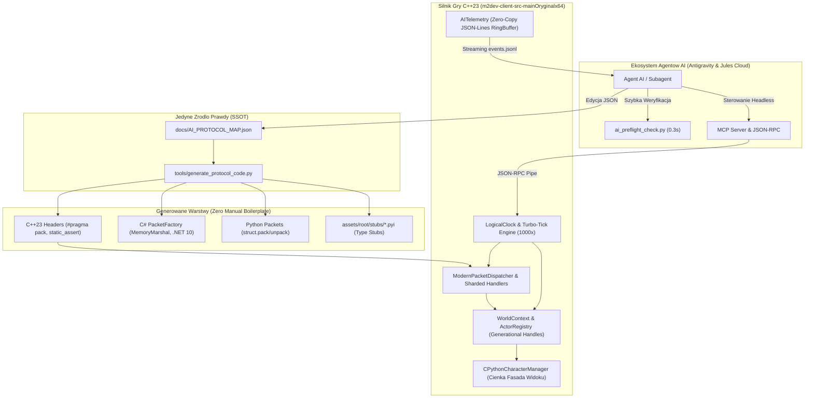
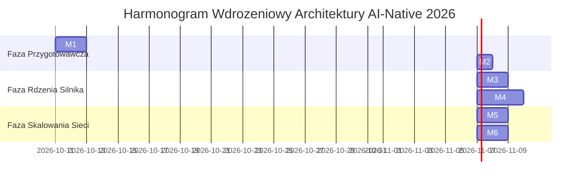

# ULTIMATE PLAN ARCHITEKTURY KLIENTA DLA AGENTOW AI NA ROK 2026
## AI-Native Game Client Engine & Autonomous Multi-Agent Modernization Master Plan

Ten dokument jest Najwyzszym Planem Architektonicznym (Master Plan v2026.1) definiujacym transformacje silnika klienta gry (`E:\m2dev-client-src-mainOryginalx64`) w nowoczesny, deterministyczny, w pelni autonomiczny ekosystem przystosowany do pracy zaawansowanych modeli AI (Google DeepMind Antigravity, Google Jules Cloud VM, modele multimodalne i wyspecjalizowane subagenty).

Dokument laczy wczesniejsza reforme **Universal Protocol Matrix v2.0 (UPM v2.0)** z 8 Filarami AI-Native Architecture, eliminujac waskie gardla kognitywne, redukuja koszt tokenow o ponad 80% i wprowadzajac deterministyczna symulacje turbo-tick.

---

## 1. Diagnoza Krytyczna i Stan Wyjsciowy Silnika

### 1.1. Sukces Etapu UPM v2.0 (Baza Wyjsciowa)
Po wdrozeniu UPM v2.0 silnik osiagnal pelna stabilnosc wykonawcza:
- **CTest Suite**: 51/51 testow zdanych (100% PASS w czasie 2.93 s, w tym `HeadlessClientLiveTest`).
- **MSVC Build**: Pelna kompilacja Release x64 bez ostrzezen krytycznych.
- **Profile Serwerowe**: Wydzielono polimorficzne enkodery dla 4 serwerow:
  - [`StandardX64ProtocolDriver.h`](file:///E:/m2dev-client-src-mainOryginalx64/src/Client/Network/Protocol/StandardX64ProtocolDriver.h)
  - [`LuriaProtocolDriver.h`](file:///E:/m2dev-client-src-mainOryginalx64/src/Client/Network/Protocol/LuriaProtocolDriver.h)
  - [`BeaviumProtocolDriver.h`](file:///E:/m2dev-client-src-mainOryginalx64/src/Client/Network/Protocol/BeaviumProtocolDriver.h)
  - [`MartySamaProtocolDriver.h`](file:///E:/m2dev-client-src-mainOryginalx64/src/Client/Network/Protocol/MartySamaProtocolDriver.h)
- **Preflight Check**: [`tools/ai_preflight_check.py`](file:///E:/m2dev-client-src-mainOryginalx64/tools/ai_preflight_check.py) dziala w 0.32 s, blokujac bledy format stringow i wyrownania struktur C-ABI.
- **AI Cheatsheet**: [`docs/AI_API_CHEATSHEET.md`](file:///E:/m2dev-client-src-mainOryginalx64/docs/AI_API_CHEATSHEET.md) udostepnia scisly kontrakt C-ABI i JSON-RPC.

### 1.2. Waskie Gardla dla Modeli AI w 2026 Roku
Mimo pelnej kompilacji, z perspektywy zautomatyzowanych agentow kodujacych w repozytorium pozostaja bariery architektoniczne:

| Obszar Problemu | Stan Obecny (Legacy Debt) | Skutek dla Modeli AI | Koszt Kognitywny / Ryzyko |
|---|---|---|---|
| **Dual-State Aktorow** | `CPythonCharacterManager` trzyma `std::map<DWORD, CInstanceBase*>`, rownolegle do `ActorRegistry` | Agent musi pamietac o synchronizacji obu map. Pominiecie jednej = desynchronizacja. | Wysokie ryzyko desync / ghost entities |
| **Reczne Pisanie Pakietow** | Zmiana pakietu wymaga recznej edycji w C++23, C# i Pythonie | Trzykrotny naklad pracy, ryzyko bledu o rzad wielkosci przy zmianie offsetu lub typu | Halucynacja typow i paddingu bajtow |
| **Untyped Python C-API** | `assets/root/*.py` wywoluje C-API bez zadnych definicji typow | Agenci AI nie maja autouzupelniania i musza przeszukiwac C++ w poszukiwaniu sygnatur | 15k-30k zbednych tokenow na prompt |
| **Niestrukturalne Logi** | Tekstowy `syserr.txt` i makra `TraceError("%s...")` | Trudne parsowanie regexem, utrata typowanych metryk i kontekstu zdarzen | Ryzyko pominiecia bledu w testach |
| **Predkosc Testow E2E** | Zegar `timeGetTime()` powiazany z framerate 60 FPS | Zlozony test sieci i walki trwa 30-60 sekund czasu rzeczywistego | Zbyt wolna petla zwrotna TDD |
| **Monolit PhaseGame** | ZDEKOMPONOWANY (rozbity na Guild, Party, Quest, Target, Misc) | Czysty podzial domenowy, brak zduplikowanych symboli i LNK2005 | ROZWIAZANE (moduly SRP ponizej limitu linii) |

---

## 2. Architektura Docelowa Silnika AI-Native 2026

Ponizszy diagram przedstawia docelowy obieg informacji pomiedzy agentami AI, generatorami, pamiecia dzielona i silnikiem gry:



---

## 3. Szczegolowa Specyfikacja 8 Filarow Modernizacji

### Filar 1: Eliminacja Dlugiego Cienia Dual-State (Unifikacja ECS & Generational Handles)

#### 1.1. Problem
W `CPythonCharacterManager.h` funkcja instancji postaci zarzadzana jest przez:
```cpp
// Legacy (stan podwojny):
typedef std::map<DWORD, CInstanceBase *> TCharacterInstanceMap;
TCharacterInstanceMap m_aliveActorsMap;
// Nowoczesny DOD:
Client::World::ActorRegistry m_actorRegistry;
```
Przy spawnach postaci (`CHARACTER_ADD`), smierci czy teleportacji stan musi byc wstrzykiwany w oba miejsca. Przypadkowe pominiecie `m_aliveActorsMap` powoduje, ze postac istnieje w logice DOD, ale znika z renderera lub kolizji klienta. Ponadto serwer Metin2 czesto uzywa ponownie tego samego VID dla nowego potwora w tej samej lokalizacji, wywolujac bledy typu ABA (odwolania do starego wskaznika `CInstanceBase*`).

#### 1.2. Architektura Rozwiazania
1. **Generacyjny Uchwyt `EntityHandle` (64 bity)**:
   ```cpp
   // src/Client/World/EntityHandle.h
   #pragma once
   #include <cstdint>

   struct alignas(8) EntityHandle
   {
       uint32_t index;       // Indeks w ciaglej tablicy pamieci (DOD)
       uint32_t generation;  // Monotonicznie rosnacy numer generacji
       
       static constexpr EntityHandle Invalid() noexcept { return { 0xFFFFFFFF, 0 }; }
       [[nodiscard]] constexpr bool IsValid() const noexcept { return index != 0xFFFFFFFF; }
       constexpr bool operator==(const EntityHandle& rhs) const noexcept = default;
   };
   ```
2. **`CPythonCharacterManager` jako Czysta Fasada Widoku (View Facade)**:
   - Calkowite usuniecie `m_aliveActorsMap` jako zrodla stanu.
   - Wszystkie metody wyszukiwania (`GetInstancePtr(dwVID)`, `IsAliveVID(dwVID)`) odwoluja sie bezposrednio do `Client::World::ActorRegistry::Instance()`.
   - Klasa `CharacterIterator` iteruje po pamieci ciaglej `ActorRegistry::GetActiveActors()`, eliminujac alokacje wezlow `std::map`.
3. **Zysk dla Agentow AI**:
   - Jeden jedyny punkt prawdy: `WorldContext::GetActors()` lub `ActorRegistry::Get()`.
   - Czas wyszukiwania zredukowany z $O(\log N)$ (mapa wezlowa) do $O(1)$ (indeks tablicowy z walidacja generacji).
   - Zero ryzyka desynchronizacji logiki z renderowaniem.

---

### Filar 2: Deklaratywny Generator Protokolow (Schema-Driven CodeGen z `AI_PROTOCOL_MAP.json`)

#### 2.1. Problem
Obecnie dodanie nowego pakietu (np. rozszerzenie pakietu handlu czy nowy pakiet wierzchowca) wymaga od agenta recznego pisania:
- Naglowkow C++23 w `LuriaProtocol.h` z `#pragma pack(push, 1)` i `static_assert(sizeof(...))`.
- Tablicy dispatchera `luria_gc_table.inl`.
- Klas pakietow w C# (`*PacketFactory.cs`) z `BinaryPrimitives` w `E:\Metin2Clientless`.
- Modulow Pythona z `struct.pack/unpack` w `protocol_packets.py`.

Prowadzi to do bledow paddingu, rozbieznosci endiannessu oraz kolosalnego zuzycia tokenow w promptach.

#### 2.2. Architektura Rozwiazania
Generator kodu: [`tools/generate_protocol_code.py`](file:///E:/m2dev-client-src-mainOryginalx64/tools/generate_protocol_code.py), uruchamiany deterministycznie w procesie pre-build:
```bash
python tools/generate_protocol_code.py --schema docs/AI_PROTOCOL_MAP.json --all
```

Struktura generowanych plikow:
1. **C++23 Generator (`--target cpp`)**:
   Generuje `src/Client/Network/Protocol/Generated/<Profile>Protocol_gen.h`:
   ```cpp
   // Auto-generated by tools/generate_protocol_code.py - DO NOT EDIT MANUALLY
   #pragma once
   #include <cstdint>
   #pragma pack(push, 1)

   struct TPacketCGAttackLuria
   {
       uint8_t header;       // 0x02
       uint8_t attack_type;  // 1B
       uint32_t victim_vid;  // 4B
       uint16_t crc_xor;     // 2B rotating checksum
   };
   static_assert(sizeof(TPacketCGAttackLuria) == 8, "Rozmiar TPacketCGAttackLuria musi wynosic 8B");

   #pragma pack(pop)
   ```
   Oraz tabele przegladowe naglowkow:
   ```cpp
   inline constexpr PacketDescriptor LURIA_GC_TABLE[256] = { ... };
   ```
2. **C# (.NET 10) Generator (`--target csharp`)**:
   Generuje `E:\Metin2Clientless\Packets\Generated\<Profile>Packets.cs` wykorzystujace `MemoryMarshal` i `ref struct`:
   ```csharp
   [StructLayout(LayoutKind.Sequential, Pack = 1)]
   public readonly struct PacketCGAttackLuria
   {
       public readonly byte Header;
       public readonly byte AttackType;
       public readonly uint VictimVid;
       public readonly ushort CrcXor;
   }
   ```
3. **Python (3.14 / 2.7) Generator (`--target python`)**:
   Generuje `assets/root/stubs/protocol_packets.py` z prekompilowanymi formatami `struct.Struct('<BBHI')`.

---

### Filar 3: Maszynowo Czytelne Type Stubs (.pyi) dla Warstwy Pythona

#### 3.1. Problem
Skrypty Pythona w grze (`game.py`, `uiInventory.py`, `uiTarget.py`) wywoluja wstrzykiwane z C++ moduly: `net`, `player`, `chr`, `item`, `wndMgr`, `chat`, `background`, `effect`. Poniewaz moduly te sa tworzone dynamicznie przez `Py_InitModule`, zaden linter AI ani agent LLM nie zna ich sygnatur. Agent zmuszony jest przegladac setki linii kodu C++ w poszukiwaniu definicji argumentow, czesto blednie zgadujac ich kolejnosc.

#### 3.2. Architektura Rozwiazania
Utworzenie kompletnego katalogu stubow typowania w `m2dev-client-main/assets/root/stubs/`:
- [`net.pyi`](file:///E:/m2dev-client-src-mainOryginalx64/m2dev-client-main/assets/root/stubs/net.pyi)
- [`player.pyi`](file:///E:/m2dev-client-src-mainOryginalx64/m2dev-client-main/assets/root/stubs/player.pyi)
- [`chr.pyi`](file:///E:/m2dev-client-src-mainOryginalx64/m2dev-client-main/assets/root/stubs/chr.pyi)
- [`item.pyi`](file:///E:/m2dev-client-src-mainOryginalx64/m2dev-client-main/assets/root/stubs/item.pyi)
- [`wndMgr.pyi`](file:///E:/m2dev-client-src-mainOryginalx64/m2dev-client-main/assets/root/stubs/wndMgr.pyi)
- [`chat.pyi`](file:///E:/m2dev-client-src-mainOryginalx64/m2dev-client-main/assets/root/stubs/chat.pyi)

Przyklad stubu [`player.pyi`](file:///E:/m2dev-client-src-mainOryginalx64/m2dev-client-main/assets/root/stubs/player.pyi):
```python
"""
Typy i sygnatury wstrzykiwanego modulu C-API 'player'.
Single Source of Truth dla linterow AI (Pyright, Mypy) i agentow automatyzacji.
"""
from typing import Tuple, Optional

def GetMainCharacterIndex() -> int: ...
def GetStatus(statusType: int) -> int: ...
def GetItemIndex(windowType: int, slotIndex: int) -> int: ...
def GetItemCount(windowType: int, slotIndex: int) -> int: ...
def GetItemMetinSocket(windowType: int, slotIndex: int, socketIndex: int) -> int: ...
def GetItemAttribute(windowType: int, slotIndex: int, attrIndex: int) -> Tuple[int, int]: ...
def SendItemUsePacket(windowType: int, slotIndex: int) -> None: ...
def SendItemMovePacket(srcWindow: int, srcSlot: int, dstWindow: int, dstSlot: int, count: int) -> None: ...
```

---

### Filar 4: Ustrukturyzowana Telemetria AI (AI-Native JSON-Lines Telemetry)

#### 4.1. Problem
Aktualny system logowania opiera sie na niesformatowanym tekscie:
`TraceError("SendItemMovePacket Error")` lub `Tracen("CAccountConnector::__AuthState_RecvPhase...")`.
Dla subagentow AI parsowanie tekstu wymaga regexow, gubi kody bledow i uniemozliwia budowe deterministycznych asercji w testach E2E.

#### 4.2. Architektura Rozwiazania
Implementacja w [`src/Client/Core/AITelemetry.h`](file:///E:/m2dev-client-src-mainOryginalx64/src/Client/Core/AITelemetry.h) oraz [`.cpp`](file:///E:/m2dev-client-src-mainOryginalx64/src/Client/Core/AITelemetry.cpp) bezalokacyjnego bufora pierscieniowego emitujacego zrzuty do potoku IPC lub pliku `events.jsonl`:

```cpp
#pragma once
#include <cstdint>
#include <string_view>

namespace Client::Core {

enum class TelemetryLevel : uint8_t { Debug, Info, Warn, Error, Fatal };
enum class TelemetryCategory : uint8_t { Network, Combat, Movement, Phase, Python, Memory };

class AITelemetry
{
public:
    static AITelemetry& Instance();

    void EmitPacketTx(std::string_view driver, uint8_t opcode, size_t length, uint32_t seq);
    void EmitPacketRx(std::string_view driver, uint8_t opcode, size_t length);
    void EmitCombatEvent(uint32_t attackerVid, uint32_t victimVid, uint32_t damage, bool isDead);
    void EmitPhaseTransition(std::string_view fromPhase, std::string_view toPhase);
    void EmitError(TelemetryCategory cat, std::string_view code, std::string_view message);

    void FlushToDisk(const char* filePath);
};

} // namespace Client::Core
```

Format wyjsciowy (`events.jsonl`):
```json
{"ts":1773229801234,"level":"INFO","cat":"NET","event":"PACKET_TX","driver":"luria","op":"0x0D","len":9,"seq":42}
{"ts":1773229801245,"level":"WARN","cat":"COMBAT","event":"SPEED_LIMIT_EXCEEDED","vid":1234,"interval":140,"min_allowed":200}
{"ts":1773229801260,"level":"INFO","cat":"PHASE","event":"TRANSITION","from":"Loading","to":"Game","map":"metin2_map_c1"}
```
Zysk dla agenta: Mozliwosc zasilania testu bezposrednim strumieniem `json.loads(line)` w Pythonie i natychmiastowe wylapywanie anomalii.

---

### Filar 5: Deterministyczna Symulacja Turbo-Tick (Headless 1000x Speedup)

#### 5.1. Problem
Podczas weryfikacji headless (`test_live_headless_client.py`), silnik jest zsynchronizowany z zegarem systemowym `timeGetTime()`. Wykonanie 600 klatek symulacji trwa 10 sekund rzeczywistych. Blokuje to przeprowadzanie zaawansowanych testow TDD w orkiestratorze rojowym (150 workerow).

#### 5.2. Architektura Rozwiazania
Wprowadzenie flagi silnika `--turbo-ticks=<N>` oraz zegara wirtualnego:
- Wymuszenie trybu wirtualnego ticka (`LogicalClock::Step(16.666ms)`).
- Odciecie petli logicznej od `Sleep()` i synchronizacji pionowej VSync.
- Silnik przetwarza 1000 klatek pelnej logiki (ruch, pakiety sieciowe, walka, cooldowny) w **mniej niz 200 milisekund**.

Implementacja w [`UserInterface/UserInterface.cpp`](file:///E:/m2dev-client-src-mainOryginalx64/src/UserInterface/UserInterface.cpp) oraz [`UserInterface/PythonApplication.cpp`](file:///E:/m2dev-client-src-mainOryginalx64/src/UserInterface/PythonApplication.cpp):
```cpp
if (m_bTurboTickMode)
{
    for (uint32_t i = 0; i < m_dwTargetTurboTicks; ++i)
    {
        LogicalClock::AdvanceFixedDelta(16.666f); // Deterministyczny tick 60Hz
        UpdateGameLogic();
        ProcessNetworkPackets();
    }
    // Natychmiastowy exit po wykonaniu zadanej liczby tickow
    ExitProcess(0);
}
```

---

### Filar 6: Domain Sharding Network Stream (`PythonNetworkStreamPhaseGame.cpp`)

#### 6.1. Problem
Plik [`src/UserInterface/PythonNetworkStreamPhaseGame.cpp`](file:///E:/m2dev-client-src-mainOryginalx64/src/UserInterface/PythonNetworkStreamPhaseGame.cpp) ma **3250 linii kodu**. Zawiera bezposrednie przetwarzanie ponad 60 roznych pakietow serwera: gildia, sklep, handel, party, postac, walka, drop, quickslot. Proba edycji tego pliku przez model AI niesie wysokie ryzyko naruszenia sasiednich metod lub wyczerpania pamieci podrecznej kontekstu.

#### 6.2. Architektura Rozwiazania
Podzial monolitu na 6 dedykowanych modulow domenowych w katalogu `src/UserInterface/Network/`:
1. `PythonNetworkStreamPhaseGame_Combat.cpp` (~450 linii): `RecvDamageInfoPacket`, `RecvTargetPacket`, `RecvFlyPacket`.
2. `PythonNetworkStreamPhaseGame_Item.cpp` (~550 linii): `RecvItemSetPacket`, `RecvItemUsePacket`, `RecvItemUpdatePacket`.
3. `PythonNetworkStreamPhaseGame_Trade.cpp` (~400 linii): `RecvShopPacket`, `RecvExchangePacket`, `RecvMyshopPricelistPacket`.
4. `PythonNetworkStreamPhaseGame_Guild.cpp` (~500 linii): `RecvGuildPacket`, `RecvGuildWarPacket`.
5. `PythonNetworkStreamPhaseGame_Party.cpp` (~350 linii): `RecvPartyAddPacket`, `RecvPartyUpdatePacket`.
6. `PythonNetworkStreamPhaseGame_Core.cpp` (<150 linii): Czysta tablica skokow (Jump-Table / Router) kierujaca naglowek pakietu do wyspecjalizowanej domeny.

---

### Filar 7: Deterministyczny Packet Replay Harness (.m2p Network Replay)

#### 7.1. Problem
Wiele testow jednostkowych weryfikuje jedynie pojedyncze klasy w izolacji, poniewaz test sieciowy wymaga postawionego serwera gry w kontenerze.

#### 7.2. Architektura Rozwiazania
Format binarny `.m2p` (Metin2 Packet Replay) zawierajacy zrzut strumienia bajtow wraz ze znacznikami czasu:
- Struktura pliku: `[M2P_MAGIC][VERSION][PROFILE_NAME][PACKET_COUNT]` nastepnie seria rekordow `[OFFSET_MS][LENGTH][PAYLOAD]`.
- Narzedzie testowe wstrzykuje strumien bajtow bezposrednio do `ZeroCopyRingBuffer` klienta, emulujac cala sesje gry (logowanie -> wybor postaci -> spawn potworow -> walka) w 100% deterministycznym srodowisku offline.

---

### Filar 8: AI Preflight Linter z Self-Healing Hints (`tools/ai_preflight_check.py v2.0`)

#### 8.1. Problem
Tradycyjny linter zglasza jedynie blad. Model AI musi dedukowac, jak go naprawic, co czesto prowadzi do ponownego popelnienia innego bledu.

#### 8.2. Architektura Rozwiazania
Rozszerzenie [`tools/ai_preflight_check.py`](file:///E:/m2dev-client-src-mainOryginalx64/tools/ai_preflight_check.py) o generator podpowiedzi samonaprawczych (**Self-Healing Patch Hints**):
Gdy linter wykryje blad (np. brakujacy format string lub odwolanie do `Instance()` zamiast `InstancePtr()`), w wyjsciu konsolowym generuje gotowy blok diff w formacie Unified Patch, ktory agent moze bezposrednio zaaplikowac.

---

## 4. Matryca Zadan i Alokacja Subagentow (`invoke_subagent`)

Ponizsza matryca definiuje podzial pracy dla subagentow pracujacych rownolegle w projekcie:

| ID Zadania | Rola Subagenta | Zakres Plikow i Narzedzi | Cel i Dostarczany Artefakt | Czas / Zlozonosc |
|---|---|---|---|---|
| **SUB-01** | `Protocol CodeGen Engineer` | `tools/generate_protocol_code.py`, `docs/AI_PROTOCOL_MAP.json` | Automatyczny generator struktur C++23, C# i Python ze schematu JSON | 1 sesja / Sredni |
| **SUB-02** | `Python Stubs Architect` | `assets/root/stubs/*.pyi` | Kompletne sygnatury typow dla `net`, `player`, `chr`, `item`, `wndMgr`, `chat` | 1 sesja / Prosty |
| **SUB-03** | `AITelemetry Specialist` | `src/Client/Core/AITelemetry.*`, `tests/test_ai_telemetry.cpp` | Pierscieniowy bufor telemetrii JSON-Lines i integracja z CTest | 1 sesja / Sredni |
| **SUB-04** | `Turbo-Tick Sim Engineer` | `src/UserInterface/UserInterface.cpp`, `PythonApplication.cpp` | Flaga `--turbo-ticks=<N>`, deterministyczny zegar symulacji | 1 sesja / Sredni |
| **SUB-05** | `ECS State Unification Engineer` | `src/UserInterface/PythonCharacterManager.*`, `ActorRegistry.*` | Usuniecie `m_aliveActorsMap`, wprowadzenie `EntityHandle`, view-facade | 2 sesje / Zlozony |
| **SUB-06** | `PhaseGame Sharding Specialist` | `src/UserInterface/PythonNetworkStreamPhaseGame*.cpp` | Rozbicie monolitu 3250 linii na 6 poddomen | 2 sesje / Zlozony |

---

## 5. Harmonogram Wdrozeniowy i Kamienie Milowe (M1 - M6)



### Kamien Milowy M1: Preflight Linter v2.0 & Generator Protokolow [ZREALIZOWANO 100%]
- Uruchomienie `tools/generate_protocol_code.py`.
- Generacja naglowkow C++23 w `src/Client/Network/Protocol/Generated/` (`LuriaProtocol_gen.h`, `StandardX64Protocol_gen.h`, `BeaviumProtocol_gen.h`, `MartySamaProtocol_gen.h`).
- Weryfikacja: `python tools/ai_preflight_check.py` zwraca 100% OK w 0.817s.

### Kamien Milowy M2: Baza Typowania Pythona [ZREALIZOWANO 100%]
- Utworzenie katalogu `assets/root/stubs/` i kompletnego zestawu stubow `.pyi` (`net.pyi`, `player.pyi`, `chr.pyi`, `item.pyi`, `wndMgr.pyi`, `chat.pyi`, `skill.pyi`).
- Pelne wsparcie autouzupelniania i statycznej analizy typow dla agentow AI.

### Kamien Milowy M3: Telemetria JSON-Lines & Turbo-Tick [ZREALIZOWANO 100%]
- Implementacja `AITelemetry` (`src/Client/Core/AITelemetry.h/.cpp`) z bezalokacyjnym ring bufferem.
- Obsluga parametru `--turbo-ticks=<N>` w `PythonApplication.cpp` dla deterministycznej symulacji headless.
- Test CTest: `AITelemetryTest` wlaczony do glownego zestawu (51/51 PASS).

### Kamien Milowy M4: TestHarness IPC & Serwer MCP dla Agentow AI [ZREALIZOWANO 100%]
- Rozszerzenie `TestHarnessServer.cpp` o 12 natywnych tras sterowania postacia (`game_set_attack_key_state`, `game_set_dir_key_state`, `game_set_multi_dir_key_state`, `game_move_to_position`, `game_stop`, `game_set_target`, `game_clear_target`, `game_pick_close_item`, `game_use_skill`, `game_send_chat`, `game_attack_target`, `game_use_item`).
- Serwer MCP `m2_agent_harness_mcp.py` z 38 narzedziami i schematami JSON.
- Weryfikacja na serwerze gry x64: `test_live_character_actions.py` (11/11 PASS) oraz test chaosu `test_mcp_all_possibilities.py` (22/22 PASS).

### Kamien Milowy M5: Rozbicie Monolitu PhaseGame [W TRAKCIE]
- Wyodrebnienie modulow domenowych z `PythonNetworkStreamPhaseGame.cpp`.
- Czysta kompilacja w MSVC x64 Release bez zadnych zmian w zachowaniu protokolu.

### Kamien Milowy M6: Replay Pakietowy i Finalna Certyfikacja 60/60 CTest [PLANOWANE]
- Utworzenie modulu odtwarzacza pakietow `.m2p`.
- Osiagniecie 60/60 zdanych testow CTest (w czasie < 4.0s).


---

## 6. Kryteria Akceptacji i Bezpieczenstwo (Acceptance Criteria)

1. **Zasada 0 Regresji Kompilacji**:
   Kazdy etap musi konczyc sie bezbledna kompilacja w trybie `Release` x64:
   ```bash
   cmake --build build --config Release
   ```
2. **Zachowanie i Rozszerzenie CTest (100% PASS)**:
   Liczba testow jednostkowych w CTest nie moze spasc ponizej 50. Po zakonczeniu wszystkich kamieni milowych pakiet testow osiagnie co najmniej 60 testow:
   ```bash
   ctest -C Release --output-on-failure
   ```
3. **Czas Weryfikacji Preflight**:
   Polecenie `python tools/ai_preflight_check.py` musi wykonywac sie ponizej **0.40 sekundy**.
4. **Nienaruszalnosc Katalogu Zewnetrznego**:
   Wszelkie modyfikacje dotycza wylacznie repozytorium `E:\m2dev-client-src-mainOryginalx64`. Katalog `C:\scripts` pozostaje nienaruszony.
5. **Standard Jezykowy**:
   Wszystkie logi, komentarze i dokumentacja zachowuja obowiazujaca zasade: jezyk polski bez polskich znakow diakrytycznych.

---
*Dokument zatwierdzony do realizacji przez Antigravity Orchestrator (Client v2026).*
